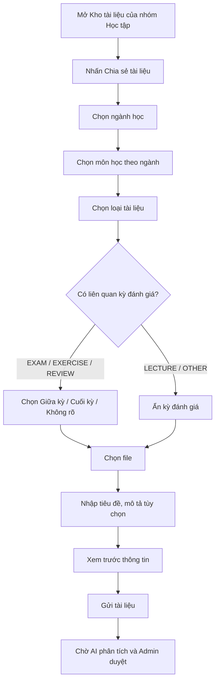

# THIẾT KẾ LẠI FORM CHIA SẺ TÀI LIỆU — NHÓM HỌC TẬP

> Tài liệu đặc tả UI/UX, dữ liệu và tích hợp dành cho Codex. Phạm vi **chỉ** là luồng chia sẻ tài liệu trong nhóm **Học tập**. Không xây dựng lại hệ thống kiểm tra file, lưu trữ R2 hoặc hệ thống duyệt hiện có.

## 1. Mục tiêu

- Giảm tình trạng tiêu đề, mô tả và loại tài liệu thiếu nhất quán.
- Cho phép sinh viên phân loại tài liệu có cấu trúc, để dễ tìm kiếm/lọc trong Kho tài liệu.
- Giữ thao tác đăng tài liệu ngắn gọn, ưu tiên trải nghiệm Flutter mobile.
- Cung cấp metadata rõ ràng cho AI Moderation Service đã được thiết kế riêng: AI kiểm tra đúng môn, tính học thuật/spam, và có thể gợi ý phân loại lại.
- **Loại bỏ hoàn toàn lựa chọn “Chuyên cần”** trong form mới.

## 2. Phạm vi và nguyên tắc

1. Chỉ áp dụng cho nhóm có loại `Học tập` và tính năng `Kho tài liệu`.
2. Giữ lựa chọn **Ngành học → Môn học** theo dữ liệu hiện có; không cho phép nhập tên ngành/môn tùy ý nếu đã có danh mục.
3. **Loại tài liệu** là trường bắt buộc, độc lập với **Kỳ đánh giá**.
4. **Kỳ đánh giá** chỉ xuất hiện khi phù hợp và chỉ có: `Giữa kỳ`, `Cuối kỳ`, `Không áp dụng / Không rõ`.
5. Tiêu đề do sinh viên nhập, mô tả không bắt buộc; không lấy tên file gốc làm tiêu đề hiển thị mặc định nếu tên khó hiểu.
6. Admin quyết định phê duyệt/từ chối; AI chỉ đề xuất và giải thích.
7. Không tự động khẳng định tài liệu là đề thi chính thức, đáp án chính thức, năm học hay tên giảng viên khi chưa có căn cứ.
8. Tái sử dụng API, schema và cơ chế upload đã có; các tên field bên dưới là hợp đồng đề xuất, cần ánh xạ vào codebase thực tế.

## 3. Danh mục phân loại

### 3.1. Loại tài liệu (`document_type`) — bắt buộc

| Mã | Tên hiển thị | Ví dụ |
|---|---|---|
| `EXAM` | Đề thi / Kiểm tra | Đề kiểm tra, đề thi tham khảo |
| `EXERCISE` | Bài tập / Thực hành | Bài tập SQL, bài thực hành |
| `LECTURE` | Giáo trình / Bài giảng | Giáo trình PDF, slide bài giảng |
| `REVIEW` | Đề cương / Ôn tập | Đề cương tổng hợp, bộ câu hỏi ôn tập |
| `OTHER` | Tài liệu khác | Tài liệu học thuật chưa phù hợp các nhóm trên |

### 3.2. Kỳ đánh giá (`assessment_type`) — có điều kiện

| Mã | Hiển thị |
|---|---|
| `MIDTERM` | Giữa kỳ |
| `FINAL` | Cuối kỳ |
| `NULL` | Không áp dụng / Không rõ |

**Quy tắc hiển thị:**
- `EXAM`: hiện lựa chọn kỳ đánh giá, khuyến khích chọn Giữa kỳ hoặc Cuối kỳ; vẫn cho phép Không rõ.
- `EXERCISE`: hiện lựa chọn kỳ đánh giá nhưng không bắt buộc (bài tập có thể dùng chung cả kỳ).
- `REVIEW`: hiện lựa chọn kỳ đánh giá nhưng không bắt buộc.
- `LECTURE`, `OTHER`: ẩn trường kỳ đánh giá và lưu `assessment_type = null`.
- Khi đổi từ loại có kỳ đánh giá sang `LECTURE`/`OTHER`, xóa giá trị kỳ đánh giá cũ trong state và payload.
- **Không thêm `ATTENDANCE` / “Chuyên cần” ở bất kỳ dropdown, filter hay enum mới nào.** Nếu DB cũ đã có giá trị này, cần migration/compatibility phù hợp, không âm thầm xóa dữ liệu cũ.

## 4. Luồng UX đề xuất



### 4.1. Thứ tự trường trên mobile

1. **Ngành học***: searchable dropdown, có thể prefill nếu có ngữ cảnh phù hợp.
2. **Môn học***: searchable dropdown, chỉ hiển thị môn thuộc ngành; khi đổi ngành phải reset môn không còn hợp lệ.
3. **Loại tài liệu***: selection cards hoặc bottom sheet, tên ngắn, icon nhất quán.
4. **Kỳ đánh giá**: radio chips, chỉ xuất hiện theo quy tắc mục 3.2.
5. **Tệp tài liệu***: file picker; hiển thị tên file, định dạng, dung lượng, trạng thái chọn.
6. **Tiêu đề tài liệu***: text field; đề xuất từ tên file đã làm sạch, cho phép sửa.
7. **Mô tả**: multiline, không bắt buộc; placeholder gợi ý mô tả nội dung, phạm vi chương, năm học nếu biết.
8. **Xem trước metadata**: tên môn · loại tài liệu · kỳ đánh giá (nếu có).
9. CTA chính: **Gửi tài liệu để duyệt**.

Dấu `*` là bắt buộc. Không tạo bước đăng nhập hoặc form phụ nếu luồng hiện tại đã có xác thực.

### 4.2. Wireframe dạng văn bản

```text
┌───────────────────────────────────────────────┐
│ ← Chia sẻ tài liệu                            │
│ Chia sẻ kiến thức với thành viên nhóm         │
│                                               │
│ Ngành học *                                   │
│ [ Công nghệ thông tin                    ▾ ]   │
│ Môn học *                                     │
│ [ Cơ sở dữ liệu                         ▾ ]   │
│                                               │
│ Loại tài liệu *                               │
│ [ Đề thi / Kiểm tra ] [ Bài tập / Thực hành ]  │
│ [ Giáo trình / Bài giảng ]                    │
│ [ Đề cương / Ôn tập ] [ Khác ]                │
│                                               │
│ Kỳ đánh giá (chỉ hiện khi phù hợp)            │
│ (●) Giữa kỳ  ( ) Cuối kỳ  ( ) Không rõ        │
│                                               │
│ Tệp tài liệu *                                │
│ [ + Chọn file ]                               │
│                                               │
│ Tiêu đề tài liệu *                            │
│ [ Đề ôn tập giữa kỳ Cơ sở dữ liệu         ]    │
│ Mô tả (tùy chọn)                              │
│ [ Gồm bài tập truy vấn SQL...             ]    │
│                                               │
│ Xem trước: Cơ sở dữ liệu · Đề thi · Giữa kỳ   │
│                                               │
│ [       Gửi tài liệu để duyệt           ]     │
└───────────────────────────────────────────────┘
```

### 4.3. Quy chuẩn giao diện

- Ưu tiên phong cách Flutter hiện có; bo góc mềm, khoảng cách thoáng, trạng thái chọn rõ, hiệu ứng chuyển đổi nhẹ.
- Trên màn hình nhỏ, dùng bottom sheet tìm kiếm cho ngành/môn; hạn chế dropdown quá dài.
- Trường kỳ đánh giá xuất hiện/biến mất bằng animation ngắn, không gây nhảy bố cục đột ngột.
- Hiển thị lỗi ngay dưới trường liên quan; không xóa dữ liệu đã nhập khi upload lỗi.
- CTA cố định phía dưới khi cần, có xử lý bàn phím và safe area trên iOS/Android.
- Có trạng thái loading, disabled khi gửi, retry hợp lý; ngăn submit lặp.
- Cung cấp nhãn trợ năng, vùng chạm đủ lớn, tương phản rõ.

## 5. Tiêu đề và mô tả

### Tiêu đề
- Bắt buộc; trim khoảng trắng, giới hạn độ dài hợp lý (đề xuất 5–120 ký tự, điều chỉnh theo backend hiện có).
- Có thể **gợi ý** từ tên file: bỏ extension, thay `_`/`-` bằng khoảng trắng, loại bỏ chuỗi ký tự vô nghĩa nếu chắc chắn.
- Không tự động thêm nhãn “Giữa kỳ”, “Cuối kỳ”, “Đề thi chính thức” nếu nội dung hoặc người đăng không xác nhận.
- Không dùng tiêu đề do AI sinh làm nguồn sự thật để kiểm duyệt; AI phải đọc nội dung file.

### Mô tả
- Không bắt buộc; giới hạn đề xuất tối đa 500 ký tự.
- Placeholder: “Ví dụ: Tài liệu gồm bài tập SQL chương 1–3, dùng để ôn giữa kỳ.”
- Tránh yêu cầu người dùng viết lại thông tin đã chọn từ dropdown.

## 6. Validation và trạng thái

| Trường | Điều kiện |
|---|---|
| `major_id` | Bắt buộc, thuộc danh mục hợp lệ |
| `subject_id` | Bắt buộc, hợp lệ trong ngành đã chọn |
| `document_type` | Bắt buộc, thuộc enum mục 3.1 |
| `assessment_type` | Chỉ `MIDTERM`, `FINAL` hoặc `null`; phải `null` với `LECTURE`, `OTHER` |
| `file` | Bắt buộc; áp dụng kiểm tra file hiện có, không thiết kế lại |
| `title` | Bắt buộc, không chỉ có khoảng trắng |
| `description` | Không bắt buộc |

- Chặn submit khi dữ liệu bắt buộc thiếu; hiển thị lỗi cụ thể.
- Backend **luôn xác thực lại** `document_type`, `assessment_type` và quan hệ ngành–môn, không tin hoàn toàn dữ liệu client.
- Nếu có lỗi mạng, giữ lại metadata và file selection nếu môi trường cho phép.
- Sau khi gửi thành công, hiển thị trạng thái **Chờ kiểm duyệt**, không thông báo tài liệu đã được công khai.

## 7. API / payload đề xuất

Tận dụng endpoint upload hiện có; bổ sung field mới trong `multipart/form-data` hoặc metadata JSON theo kiến trúc hiện tại.

```json
{
  "group_id": "GROUP_123",
  "major_id": "MAJOR_IT",
  "subject_id": "SUBJECT_DB",
  "document_type": "EXAM",
  "assessment_type": "MIDTERM",
  "title": "Đề ôn tập giữa kỳ Cơ sở dữ liệu",
  "description": "Bộ câu hỏi về mô hình quan hệ và SQL"
}
```

File thực tế gửi bằng field/file upload hiện có; JSON trên chỉ minh họa **metadata**, không phải payload chứa bytes. Các ID là giá trị giả định, không phải mã thật trong DB.

**Response thành công** (minh họa):

```json
{
  "document_id": "DOC_001",
  "moderation_status": "PENDING",
  "message": "Tài liệu đã được gửi và đang chờ kiểm duyệt."
}
```

## 8. Thay đổi dữ liệu

Nếu bảng tài liệu hiện tại đã có `major_id`, `subject_id`, `title`, `description`, chỉ cần bổ sung:

```sql
-- Ví dụ PostgreSQL; điều chỉnh theo schema và migration framework hiện tại.
ALTER TABLE documents
  ADD COLUMN IF NOT EXISTS document_type VARCHAR(20),
  ADD COLUMN IF NOT EXISTS assessment_type VARCHAR(20);
```

- Với dữ liệu mới, backend yêu cầu `document_type` hợp lệ.
- Với dữ liệu cũ chưa có phân loại, giữ `NULL` và hiển thị “Chưa phân loại”, hoặc triển khai backfill được Admin xác minh. Không gán `OTHER` hàng loạt nếu không có cơ sở.
- Có thể dùng CHECK constraints hoặc bảng danh mục tùy convention dự án.
- Chỉ bổ sung index nếu có truy vấn lọc thực tế; ví dụ `(subject_id, document_type, assessment_type)`.
- **Không tự ý sửa/xóa dữ liệu hiện hữu.**

## 9. Tích hợp AI Moderation hiện có

AI Moderation vẫn giữ hai nhiệm vụ chính:
1. Kiểm tra tài liệu có liên quan đến môn đã chọn.
2. Kiểm tra nội dung có tính học tập hay chủ yếu quảng cáo/spam.

**Bổ sung nhẹ:** AI có thể đánh giá metadata loại tài liệu có khớp nội dung hay không; không bắt buộc triển khai trong bản đầu nếu muốn tối giản.

```json
{
  "document_id": "DOC_001",
  "selected_subject": "Cơ sở dữ liệu",
  "declared_document_type": "EXAM",
  "declared_assessment_type": "MIDTERM",
  "subject_relevance": "RELEVANT",
  "content_type": "ACADEMIC",
  "category_match": "UNCERTAIN",
  "recommendation": "REVIEW",
  "reason": "Nội dung có kiến thức về Cơ sở dữ liệu nhưng chưa đủ căn cứ xác nhận đây là đề giữa kỳ."
}
```

**Quy tắc:**
- Không từ chối chỉ vì không xác minh được nhãn Giữa kỳ/Cuối kỳ; nếu không chắc, đề xuất `REVIEW`.
- Khi tài liệu hợp lệ nhưng sai loại, gợi ý **chỉnh phân loại** thay vì xem như spam.
- AI không tự sửa metadata đã đăng hoặc tự duyệt tài liệu.
- Kết quả AI cần có lý do ngắn gọn để Admin dễ ra quyết định.

## 10. Hiển thị và lọc ở Kho tài liệu

- Card tài liệu hiển thị: **Tiêu đề**, môn học, chip loại tài liệu, chip Giữa kỳ/Cuối kỳ (nếu có), định dạng file, người đăng và trạng thái khi phù hợp.
- Bộ lọc: **Môn học**, **Loại tài liệu**, **Kỳ đánh giá** (Giữa kỳ/Cuối kỳ); cho phép reset.
- Không tạo cây thư mục vật lý trên R2 theo loại tài liệu chỉ để phục vụ UI; nên lọc bằng metadata DB.
- Search theo tiêu đề, môn học; có thể mở rộng full-text search sau.

## 11. Acceptance criteria / Checklist cho Codex

- [ ] Form chỉ xuất hiện ở nhóm `Học tập` có quyền chia sẻ tài liệu.
- [ ] Chọn ngành làm thay đổi danh sách môn học hợp lệ.
- [ ] Bắt buộc chọn loại tài liệu theo 5 nhóm quy định.
- [ ] Kỳ đánh giá chỉ có `Giữa kỳ`, `Cuối kỳ`, `Không áp dụng / Không rõ`.
- [ ] **Không còn “Chuyên cần” trong UI và các lựa chọn mới.**
- [ ] Chọn `LECTURE`/`OTHER` sẽ ẩn và reset kỳ đánh giá.
- [ ] Tiêu đề bắt buộc; mô tả tùy chọn.
- [ ] File và metadata được gửi bằng flow upload hiện có.
- [ ] Sau upload hiển thị “Chờ kiểm duyệt”; không công khai trước khi Admin duyệt.
- [ ] Backend validate enum và quan hệ ngành–môn.
- [ ] Kho tài liệu hiển thị và lọc được theo loại/kỳ đánh giá.
- [ ] Metadata được chuyển cho AI Moderation Service; AI không có quyền duyệt trực tiếp.
- [ ] Có test cho conditional fields, reset state, validation, submit, và dữ liệu cũ chưa phân loại.
- [ ] Không phá vỡ luồng upload/duyệt hiện có.

## 12. Hướng dẫn triển khai cho Codex

1. Đọc kiến trúc Flutter/backend và schema hiện tại trước khi sửa; xác định form upload, model, API, màn hình Kho tài liệu, bộ lọc và luồng Admin.
2. Chỉ thay đổi các phần cần thiết để hỗ trợ metadata mới; tái sử dụng component, theme và state management hiện có.
3. Tạo migration an toàn và backward-compatible; không tự đặt tên bảng/route nếu codebase đã có convention khác.
4. Cập nhật model/DTO, form validation, request/response, danh sách tài liệu và bộ lọc.
5. Tích hợp AI chỉ ở mức truyền metadata mới; không viết lại AI Moderation Service.
6. Thêm test và chạy lint/build phù hợp; báo cáo file thay đổi, migration, API contract và các trường hợp cần cấu hình.

---

**Tóm tắt quyết định sản phẩm:** Giữ `Ngành → Môn`; thêm `Loại tài liệu` bắt buộc; `Giữa kỳ/Cuối kỳ` là metadata có điều kiện; bỏ `Chuyên cần`; giữ tiêu đề có thể chỉnh sửa và mô tả tùy chọn; AI chỉ hỗ trợ phân tích, Admin quyết định duyệt.
