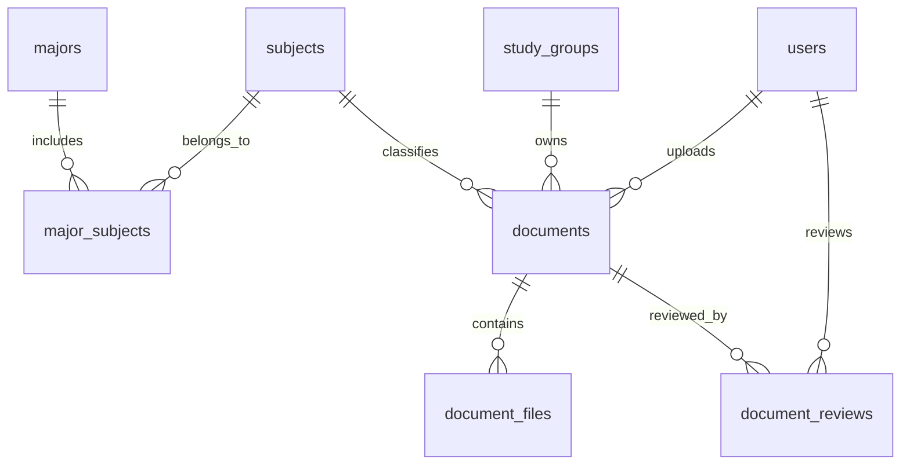

# Danh mục học phần Học viện Ngân hàng và đề xuất thiết kế cơ sở dữ liệu
> **Nguồn:** `Học phần.docx` do người dùng cung cấp. Giữ nguyên phân loại **Đại cương** và **Chuyên ngành theo ngành**; không tự thêm môn hoặc suy đoán mã còn thiếu. Dữ liệu bên dưới được liệt kê từ bản trích xuất có cấu trúc của chính tài liệu đó. Đây không phải xác nhận độc lập từ Học viện Ngân hàng.

## 1. Tổng quan và nguyên tắc
- **18 ngành**, **29 bản ghi học phần đại cương**, **355 bản ghi học phần duy nhất theo cách trích xuất**, **481 liên kết ngành–học phần**.
- Đại cương dùng chung ở cấp hệ thống; học phần chuyên ngành được hiển thị trong ngành tương ứng. Không suy ra rằng mọi ngành đều bắt buộc học tất cả môn đại cương.
- Một học phần có thể liên kết nhiều ngành; kho tài liệu thực tế thuộc **từng Nhóm Học tập**, không áp dụng cho các loại hội nhóm khác.
- Mã học phần trùng nhưng tên khác nhau **không được tự động gộp**. Giữ bản ghi riêng và đánh dấu cần rà soát.

## 2. Danh sách môn đại cương (giữ nguyên từ nguồn)
| STT | Mã học phần | Tên học phần |
|---:|---|---|
| 1 | PLT07A | Triết học Mác Lênin |
| 2 | PLT08A | Kinh tế chính trị Mác - Lênin |
| 3 | PLT09A | Chủ nghĩa xã hội khoa học |
| 4 | PLT10A | Lịch sử Đảng Cộng sản Việt Nam |
| 5 | PLT06A | Tư tưởng Hồ Chí Minh |
| 6 | LAW01A | Pháp luật đại cương (trừ ngành Luật) |
| 7 | IS52A | Năng lực số ứng dụng |
| 8 | MAT15A | Toán kinh tế (các ngành khối Kinh tế, Tài chính, Kinh doanh) |
| 9 | MAT14A | Xác suất và thống kê |
| 10 | MGT36A | Đổi mới sáng tạo và khởi nghiệp |
| 11 | BUS20A | Giao tiếp trong kinh doanh |
| 12 | ENG01A | Tiếng Anh I |
| 13 | ENG02A | Tiếng Anh II |
| 14 | ENG03A | Tiếng Anh III |
| 15 | ENG04A | Tiếng Anh IV |
| 16 | JAP401J | Tiếng Nhật I |
| 17 | JAP402J | Tiếng Nhật II |
| 18 | JAP403J | Tiếng Nhật III |
| 19 | JAP404J | Tiếng Nhật IV |
| 20 | JAP405J | Tiếng Nhật V |
| 21 | JAP406J | Tiếng Nhật VI |
| 22 | SPT07A | Giáo dục quốc phòng và an ninh |
| 23 | SPT02A | Giáo dục thể chất Đại cương |
| 24 | SPT03A | Giáo dục thể chất tự chọn |
| 25 | SPT04A | Giáo dục thể chất tự chọn |
| 26 | SPT05A | Giáo dục thể chất tự chọn |
| 27 | SPT06A | Giáo dục thể chất tự chọn |
| 28 | SPT08A | Giáo dục thể chất tự chọn |
| 29 | SPT09A | Giáo dục thể chất tự chọn |

## 3. Danh sách ngành và học phần chuyên ngành

### 3.1. Kinh tế quốc tế — mã ngành: `ECON03` (15 môn)
| STT | Mã học phần | Tên học phần |
|---:|---|---|
| 1 | ECO53A | Kinh tế vĩ mô quốc tế và địa kinh tế |
| 2 | ECO55A | Toàn cầu hóa |
| 3 | ECO56A | Chính sách kinh tế đối ngoại và phát triển bền vững |
| 4 | ECO57A | Phân tích kinh tế và tài chính dự án đầu tư quốc tế |
| 5 | ECO58A | Quản lý dự án trong môi trường số |
| 6 | FIN76A | Thanh toán quốc tế |
| 7 | BUS01A | Giao dịch thương mại quốc tế |
| 8 | ECO59A | Đấu thầu quốc tế |
| 9 | ECO60A | Quản lý rủi ro dự án đầu tư quốc tế |
| 10 | BUS21A | Chứng từ và thực hành xuất nhập khẩu |
| 11 | BUS14A | Logistics và Vận tải quốc tế |
| 12 | BUS22A | Đàm phán trong kinh doanh quốc tế |
| 13 | BUS11A | Chính sách và nghiệp vụ hải quan |
| 14 | ECO61A | Phân tích yêu cầu và giá trị dự án |
| 15 | MKT03A | Marketing quốc tế |

### 3.2. Kế toán (định hướng Nhật Bản) — mã ngành: `ACT06` (16 môn)
| STT | Mã học phần | Tên học phần |
|---:|---|---|
| 1 | ACT13J | Kế toán tài chính II |
| 2 | ACT14J | Kế toán tài chính III |
| 3 | ACT19J | Kiểm toán tài chính I |
| 4 | ACT29J | Tổ chức công tác kế toán trong môi trường công nghệ |
| 5 | ACT07J | Kế toán quốc tế |
| 6 | ACT27J | Các vấn đề kế toán đương đại |
| 7 | ACT48J | Kế toán quản trị II |
| 8 | MIS01J | Hệ thống thông tin kế toán |
| 9 | ACT72J | Kế toán trong môi trường số |
| 10 | ACT21J | Kiểm toán hoạt động |
| 11 | ACT20J | Kiểm toán tài chính II |
| 12 | ACT76J | Đạo đức nghề nghiệp |
| 13 | JAP501J | Tiếng Nhật chuyên ngành trong Kinh doanh và Kế toán |
| 14 | JAP502J | Kế toán Nhật Bản - Nhập môn |
| 15 | JAP503J | Kế toán Nhật Bản - Sơ cấp (CPA I) |
| 16 | JAP504J | Kế toán Nhật Bản - Trung cấp (CPA II) |

### 3.3. Luật học — mã ngành: `LAW04` (31 môn)
| STT | Mã học phần | Tên học phần |
|---:|---|---|
| 1 | LAW24A | Luật Hành chính |
| 2 | LAW18A | Luật Dân sự II |
| 3 | LAW65A | Luật Tố tụng dân sự |
| 4 | LAW47A | Luật Hình sự II |
| 5 | LAW41A | Luật Tố tụng hình sự |
| 6 | LAW25A | Công pháp quốc tế |
| 7 | LAW28A | Tư pháp quốc tế |
| 8 | LAW29A | Luật Đất đai |
| 9 | LAW66A | Luật Lao động |
| 10 | LAW39A | Luật Sở hữu trí tuệ |
| 11 | LAW06A | Luật Thương mại quốc tế |
| 12 | LAW67A | Luật Thương mại |
| 13 | LAW68A | Pháp luật tài chính - ngân hàng |
| 14 | LAW69A | Luật Hôn nhân và gia đình |
| 15 | LAW74A | Kỹ năng tư vấn pháp luật trong lĩnh vực dân sự |
| 16 | LAW75A | Kỹ năng tư vấn pháp luật trong lĩnh vực hình sự |
| 17 | LAW76A | Kỹ năng tư vấn pháp luật trong lĩnh vực hành chính |
| 18 | LAW70A | Tội phạm học |
| 19 | LAW72A | Luật Tố tụng hành chính |
| 20 | LAW73A | Pháp luật ASEAN |
| 21 | LAW37A | Xây dựng văn bản pháp luật |
| 22 | LAW77A | Luật Thi hành án hình sự |
| 23 | LAW78A | Những vấn đề cơ bản về Luật hình sự quốc tế |
| 24 | LAW79A | Tư pháp đối với người chưa thành niên |
| 25 | LAW80A | Luật Thi hành án dân sự |
| 26 | LAW81A | Pháp luật về biện pháp bảo đảm thực hiện nghĩa vụ |
| 27 | LAW82A | Pháp luật an sinh xã hội |
| 28 | LAW83A | Luật Công chứng |
| 29 | LAW84A | Luật Khiếu nại, tố cáo |
| 30 | LAW85A | Pháp luật về quyền con người |
| 31 | LAW71A | Pháp luật phòng, chống tham nhũng |

### 3.4. Kế toán — mã ngành: `ACT02` (30 môn)
| STT | Mã học phần | Tên học phần |
|---:|---|---|
| 1 | ECO01A | Kinh tế vi mô |
| 2 | ECO02A | Kinh tế vĩ mô |
| 3 | ACT01A | Nguyên lý kế toán |
| 4 | LAW02A | Luật kinh tế |
| 5 | FIN82A | Tài chính tiền tệ |
| 6 | ACT02A | Kế toán tài chính I |
| 7 | FIN02A | Tài chính doanh nghiệp 1 |
| 8 | SCM03A | Phương pháp nghiên cứu khoa học trong kinh doanh |
| 9 | ACT30A | Nguyên lý thống kê |
| 10 | MGT02A | Quản trị doanh nghiệp |
| 11 | ACT08A | Kiểm toán căn bản |
| 12 | ACT15A | Kế toán thuế |
| 13 | MIS02A | Hệ thống thông tin quản lý |
| 14 | ACT47A | Kế toán quản trị I |
| 15 | FIN17A | Ngân hàng thương mại |
| 16 | FIN25A | Tài chính doanh nghiệp II |
| 17 | BUS01A | Giao dịch thương mại quốc tế |
| 18 | FIN104A | Nguyên lý thẩm định giá tài sản |
| 19 | ACT12A | Thống kê doanh nghiệp |
| 20 | FIN55A | Phân tích tài chính doanh nghiệp I |
| 21 | ACT13A | Kế toán tài chính II |
| 22 | ACT19A | Kiểm toán tài chính I |
| 23 | ACT29A | Tổ chức công tác kế toán trong môi trường công nghệ |
| 24 | ACT05A | Kế toán công |
| 25 | ACT14A | Kế toán tài chính III |
| 26 | MIS01A | Hệ thống thông tin kế toán |
| 27 | ACT72A | Kế toán trong môi trường số |
| 28 | ACT21A | Kiểm toán hoạt động |
| 29 | ACT20A | Kiểm toán tài chính II |
| 30 | ACT76A | Đạo đức nghề nghiệp |

### 3.5. Kiểm toán — mã ngành: `ACT04` (34 môn)
| STT | Mã học phần | Tên học phần |
|---:|---|---|
| 1 | ACT13A | Kế toán tài chính II |
| 2 | ACT19A | Kiểm toán tài chính I |
| 3 | ACT72A | Kế toán trong môi trường số |
| 4 | ACT20A | Kiểm toán tài chính II |
| 5 | ACT76A | Đạo đức nghề nghiệp |
| 6 | ACT75A | Kiểm toán tài chính III |
| 7 | ACT21A | Kiểm toán hoạt động |
| 8 | ACT22A | Kiểm soát quản lý |
| 9 | ACT73A | Kiểm toán nội bộ |
| 10 | ACT74A | Kiểm toán trong môi trường công nghệ thông tin |
| 11 | ACT05A | Kế toán công |
| 12 | ACT07A | Kế toán quốc tế |
| 13 | MIS01A | Hệ thống thông tin kế toán |
| 14 | ACT14A | Kế toán tài chính III |
| 15 | BUS20A | Giao tiếp trong kinh doanh |
| 16 | ACT01A | Nguyên lý kế toán |
| 17 | LAW02A | Luật kinh tế |
| 18 | FIN82A | Tài chính tiền tệ |
| 19 | ACT02A | Kế toán tài chính I |
| 20 | FIN02A | Tài chính doanh nghiệp I |
| 21 | SCM03A | Phương pháp nghiên cứu khoa học trong kinh doanh |
| 22 | ACT30A | Nguyên lý thống kê |
| 23 | MGT02A | Quản trị doanh nghiệp |
| 24 | ACT08A | Kiểm toán căn bản |
| 25 | ACT15A | Kế toán thuế |
| 26 | ENG04A | Tiếng Anh IV |
| 27 | MIS02A | Hệ thống thông tin quản lý |
| 28 | ACT47A | Kế toán quản trị I |
| 29 | FIN17A | Ngân hàng thương mại |
| 30 | FIN25A | Tài chính doanh nghiệp II |
| 31 | BUS01A | Giao dịch thương mại quốc tế |
| 32 | FIN104A | Nguyên lý thẩm định giá tài sản |
| 33 | ACT12A | Thống kê doanh nghiệp |
| 34 | FIN55A | Phân tích tài chính doanh nghiệp I |

### 3.6. Ngân hàng — mã ngành: `BANK02` (32 môn)
| STT | Mã học phần | Tên học phần |
|---:|---|---|
| 1 | FIN20A | Quản trị ngân hàng |
| 2 | FIN19A | Tín dụng ngân hàng |
| 3 | FIN101A | Ngân hàng số |
| 4 | FIN123A | Chuẩn mực báo cáo tài chính quốc tế trong tổ chức tài chính |
| 5 | FIN124A | Môi trường, xã hội và quản trị trong tài chính - ngân hàng |
| 6 | MGT35A | Đạo đức nghề nghiệp và phát triển bền vững |
| 7 | FIN96A | Đề án ngân hàng |
| 8 | FIN109A | Thẩm định và Tài trợ dự án |
| 9 | FIN35A | Quản trị rủi ro tín dụng |
| 10 | ACT28A | Kiểm soát - kiểm toán nội bộ ngân hàng thương mại |
| 11 | FIN103A | Dịch vụ ngân hàng tư nhân |
| 12 | FIN110A | Thanh toán quốc tế và Tài trợ thương mại quốc tế |
| 13 | FIN68A | Kỹ năng giao dịch trong ngân hàng |
| 14 | ECO01A | Kinh tế vi mô |
| 15 | ECO02A | Kinh tế vĩ mô |
| 16 | LAW02A | Luật kinh tế |
| 17 | MAT16A | Phân tích định lượng trong kinh tế |
| 18 | FIN86A | Tài chính - tiền tệ |
| 19 | FIN03A | Tài chính quốc tế |
| 20 | FIN17A | Ngân hàng thương mại |
| 21 | ACT01A | Nguyên lý kế toán |
| 22 | ACT02A | Kế toán tài chính I |
| 23 | FIN02A | Tài chính doanh nghiệp I |
| 24 | FIN55A | Phân tích tài chính doanh nghiệp I |
| 25 | FIN13A | Thị trường chứng khoán |
| 26 | FIN93A | Công cụ phái sinh |
| 27 | MIS02A | Hệ thống thông tin quản lý |
| 28 | MKT22A | Marketing dịch vụ tài chính - ngân hàng |
| 29 | FIN112A | Phân tích dữ liệu trong tài chính - ngân hàng |
| 30 | MGT02A | Quản trị doanh nghiệp |
| 31 | FIN07A | Bảo hiểm |
| 32 | ACT25A | Hệ thống thanh toán |

### 3.7. Ngân hàng số — mã ngành: `BANK03` (14 môn)
| STT | Mã học phần | Tên học phần |
|---:|---|---|
| 1 | FIN20A | Quản trị ngân hàng |
| 2 | FIN19A | Tín dụng ngân hàng |
| 3 | ACT70A | Kế toán ngân hàng |
| 4 | IS24A | Kho dữ liệu và kinh doanh thông minh |
| 5 | ACT25A | Hệ thống thanh toán |
| 6 | FIN68A | Kỹ năng giao dịch trong ngân hàng |
| 7 | FIN103A | Dịch vụ Ngân hàng tư nhân |
| 8 | FIN110A | Thanh toán quốc tế và Tài trợ thương mại quốc tế |
| 9 | ACT28A | Kiểm soát - Kiểm toán nội bộ NHTM |
| 10 | FIN35A | Quản trị rủi ro tín dụng |
| 11 | FIN109A | Thẩm định và Tài trợ dự án |
| 12 | IS58A | Phân tích nghiệp vụ |
| 13 | IS60A | Quản lý dự án công nghệ thông tin |
| 14 | FIN120A | Đề án Ngân hàng số |

### 3.8. Quản trị kinh doanh — mã ngành: `BUS02` (16 môn)
| STT | Mã học phần | Tên học phần |
|---:|---|---|
| 1 | MGT01A | Quản trị học |
| 2 | MGT44A | Quản trị chuỗi cung ứng |
| 3 | MKT18A | Quản trị truyền thông |
| 4 | MGT04A | Quản trị chiến lược |
| 5 | MKT05A | Quản trị Marketing |
| 6 | MGT06A | Quản trị sản xuất và tác nghiệp |
| 7 | MGT05A | Quản trị chất lượng |
| 8 | MGT64A | Lãnh đạo |
| 9 | MGT43A | Khởi sự kinh doanh |
| 10 | MGT61A | Quản trị rủi ro trong kinh doanh |
| 11 | MGT14A | Kế hoạch kinh doanh |
| 12 | MKT08A | Hành vi tiêu dùng |
| 13 | MKT03A | Marketing quốc tế |
| 14 | MKT09A | Nghiên cứu Marketing |
| 15 | MKT20A | Marketing dịch vụ |
| 16 | MKT19A | Quản trị bán hàng |

### 3.9. Quản trị du lịch — mã ngành: `BUS03` (27 môn)
| STT | Mã học phần | Tên học phần |
|---:|---|---|
| 1 | ECO01A | Kinh tế vi mô |
| 2 | ECO02A | Kinh tế vĩ mô |
| 3 | ACT01A | Nguyên lý kế toán |
| 4 | FIN86A | Tài chính - tiền tệ |
| 5 | MGT01A | Quản trị học |
| 6 | TRM02A | Tài nguyên du lịch |
| 7 | TRM03A | Kinh tế du lịch |
| 8 | TRM04A | Tổng quan du lịch |
| 9 | FIN27A | Quản trị tài chính doanh nghiệp |
| 10 | MGT04A | Quản trị chiến lực |
| 11 | MGT03A | Quản trị nhân lực |
| 12 | MKT08A | Hành vi tiêu dùng |
| 13 | MGT45A | Quản trị thương hiệu |
| 14 | MGT37A | Văn hóa doanh nghiệp |
| 15 | MGT12A | Hành vi tổ chức |
| 16 | TRM05A | Chuyên đề các loại hình du lịch |
| 17 | MGT47A | Quản trị tác nghiệp du lịch |
| 18 | MGT48A | Khởi sự kinh doanh trong du lịch |
| 19 | MKT11A | Marketing du lịch |
| 20 | TRM06A | Quản trị kinh doanh lữ hành |
| 21 | TRM07A | Quản trị điểm đến du lịch |
| 22 | TRM08A | Hướng dẫn du lịch |
| 23 | TRM09A | Du lịch bền vững |
| 24 | TRM11A | Quản trị khách sạn |
| 25 | TRM12A | Quản trị lễ tân khách sạn |
| 26 | TRM13A | Quản trị nhà hàng |
| 27 | TRM15A | Quản trị sự kiện |

### 3.10. Kinh tế đầu tư — mã ngành: `Chưa có` (22 môn)
| STT | Mã học phần | Tên học phần |
|---:|---|---|
| 1 | ECO01A | Kinh tế vi mô |
| 2 | ECO02A | Kinh tế vĩ mô |
| 3 | ECO05A | Kinh tế công cộng |
| 4 | ECO15A | Phân tích dữ liệu và dự báo kinh tế |
| 5 | MKT21A | Marketing |
| 6 | FIN27A | Phân tích kinh tế trong đầu tư |
| 7 | ECO10A | Kinh tế học quản lý |
| 8 | FIN17A | Ngân hàng thương mại |
| 9 | MGT02A | Quản trị doanh nghiệp |
| 10 | FIN03A | Tài chính quốc tế |
| 11 | ECO34A | Quản lý dự án 2 |
| 12 | ECO25A | Đấu thầu |
| 13 | ECO26A | Lập dự án |
| 14 | ECO20A | Quản lý rủi ro dự án |
| 15 | ECO27A | Kế hoạch hóa phát triển |
| 16 | ECO28A | Đánh giá tác động của chương trình, dự án |
| 17 | ECO31A | Kinh tế đầu tư I |
| 18 | ECO03A | Kinh tế quốc tế |
| 19 | ECO04A | Kinh tế phát triển |
| 20 | ECO33A | Quản lý dự án 1 |
| 21 | ECO32A | Kinh tế đầu tư 2 |
| 22 | ECO13A | Kinh tế số |

### 3.11. Tài chính — mã ngành: `ECON01` (34 môn)
| STT | Mã học phần | Tên học phần |
|---:|---|---|
| 1 | ECO01A | Kinh tế vi mô |
| 2 | ECO02A | Kinh tế vĩ mô |
| 3 | MAT16A | Phân tích định lượng trong kinh tế |
| 4 | FIN86A | Tài chính - tiền tệ |
| 5 | FIN03A | Tài chính quốc tế |
| 6 | FIN17A | Ngân hàng thương mại |
| 7 | ACT01A | Nguyên lý kế toán |
| 8 | ACT02A | Kế toán tài chính I |
| 9 | FIN02A | Tài chính doanh nghiệp I |
| 10 | FIN55A | Phân tích tài chính doanh nghiệp I |
| 11 | FIN13A | Thị trường chứng khoán |
| 12 | FIN93A | Công cụ phái sinh |
| 13 | FIN104A | Nguyên lý thẩm định giá tài sản |
| 14 | FIN06A | Thuế |
| 15 | MGT02A | Quản trị doanh nghiệp |
| 16 | FIN30A | Tài chính công |
| 17 | FIN07A | Bảo hiểm |
| 18 | FIN102A | Ngân hàng Trung ương và Chính sách tiền tệ |
| 19 | IS42A | Trí tuệ nhân tạo trong kinh doanh |
| 20 | FIN84A | Đầu tư tài chính |
| 21 | FIN25A | Tài chính doanh nghiệp II |
| 22 | FIN75A | Quản trị rủi ro tài chính |
| 23 | FIN108A | Tài trợ khởi nghiệp |
| 24 | FIN122A | Công nghệ tài chính |
| 25 | MGT34A | Đạo đức nghề nghiệp |
| 26 | FIN02A | Tài chính doanh nghiệp |
| 27 | FIN99A | Chiến lược tài chính doanh nghiệp |
| 28 | FIN41A | Phân tích tài chính doanh nghiệp II |
| 29 | FIN100A | Ngân hàng đầu tư |
| 30 | FIN106A | Quản trị gia sản và danh mục đầu tư |
| 31 | FIN107A | Tài chính hành vi |
| 32 | FIN111A | Hoạch định thuế trong kinh doanh |
| 33 | FIN95A | Thuế quốc tế |
| 34 | FIN79A | Quản lý thuế |

### 3.12. Ngôn ngữ anh — mã ngành: `FL01` (33 môn)
| STT | Mã học phần | Tên học phần |
|---:|---|---|
| 1 | ENG60A | Ngữ âm |
| 2 | ENG48A | Nghe Nói I |
| 3 | ENG56A | Đọc viết I |
| 4 | ENG61A | Ngữ pháp ứng dụng |
| 5 | ENG12A | Nghe nói II |
| 6 | ENG57A | Đọc viết II |
| 7 | ENG08A | Ngữ nghĩa từ vựng học |
| 8 | ENG13A | Nghe nói III |
| 9 | ENG58A | Đọc viết III |
| 10 | ENG55A | Biên dịch |
| 11 | ENG17A | Kỹ năng Đọc có phân tích |
| 12 | ENG71A | Phương pháp nghiên cứu khoa học |
| 13 | ENG14A | Nghe nói IV |
| 14 | ENG59A | Đọc viết IV |
| 15 | ENG63A | Phiên dịch |
| 16 | ACT01A | Nguyên lý kế toán |
| 17 | FIN86A | Tài chính - tiền tệ |
| 18 | FIN45A | Thị trường chứng khoán |
| 19 | FIN45A | Ngân hàng thương mại |
| 20 | FIN42A | Tài chính doanh nghiệp I |
| 21 | FIN47A | Thanh toán quốc tế |
| 22 | MGT20A | Quản trị học |
| 23 | ENG72A | Tiếng Anh chuyên ngành I |
| 24 | ENG73A | Tiếng Anh chuyên ngành II |
| 25 | ENG33A | Giao tiếp liên văn hóa |
| 26 | ENG46A | Thư tín thương mại |
| 27 | ENG37A | Kỹ năng tranh biện |
| 28 | ENG74A | Tiếng Anh Tài chính - Ngân hàng |
| 29 | MKT25A | Marketing dịch vụ tài chính - ngân hàng |
| 30 | ENG69A | Đàm phán trong kinh doanh |
| 31 | MGT19A | Hành vi tổ chức |
| 32 | FIN114A | Ngân hàng số |
| 33 | FIN116A | Đầu tư tài chính |

### 3.13. Logistic chuỗi cung ứng — mã ngành: `IB02` (18 môn)
| STT | Mã học phần | Tên học phần |
|---:|---|---|
| 1 | BUS22A | Đàm phán trong kinh doanh quốc tế |
| 2 | FIN53A | Đầu tư quốc tế |
| 3 | FIN06A | Thuế |
| 4 | FIN17A | Ngân hàng thương mại |
| 5 | LAW06A | Luật thương mại quốc tế |
| 6 | MGT02A | Quản trị doanh nghiệp |
| 7 | BUS29A | Quản lý mua hàng toàn cầu |
| 8 | BUS30A | Tài trợ chuỗi cung ứng |
| 9 | FIN76A | Thanh toán quốc tế |
| 10 | BUS11A | Chính sách và nghiệp vụ hải quan |
| 11 | BUS14A | Logistic và vận tải quốc tế |
| 12 | BUS31A | Quản lý kho hàng và phân phối |
| 13 | BUS21A | Chứng từ và thực hành xuất nhập khẩu |
| 14 | BUS23A | Quản lý rủi ro và bảo hiểm trong kinh doanh quốc tế |
| 15 | MGT33A | Quản trị dự án và đầu tư quốc tế |
| 16 | BUS32A | E-Logistic |
| 17 | BUS33A | Kinh doanh Logistic |
| 18 | MKT18A | Quản trị truyền thông |

### 3.14. Công nghệ thông tin — mã ngành: `IT01` (30 môn)
| STT | Mã học phần | Tên học phần |
|---:|---|---|
| 1 | MAT12A | Đại số tuyến tính |
| 2 | MAT13A | Giải tích |
| 3 | IS57A | Nhập môn ngành Công nghệ thông tin |
| 4 | IS22A | Cơ sở lập trình |
| 5 | MAT14A | Xác suất thống kê |
| 6 | MAT05A | Toán rời rạc |
| 7 | IS21A | Cơ sở dữ liệu |
| 8 | IS53A | Kiến trúc máy tính và hệ điều hành |
| 9 | IS07A | Cấu trúc dữ liệu và giải thuật |
| 10 | IS53A | Thiết kế Cơ sở dữ liệu |
| 11 | IS27A | Lập trình hướng đối tượng |
| 12 | IS06A | Mạng và truyền thông |
| 13 | IS19A | Thiết kế Web |
| 14 | MIS07A | Hệ quản trị Cơ sở dữ liệu |
| 15 | MIS08A | Phân tích thiết kế hệ thống |
| 16 | IS23A | Khai phá và phân tích dữ liệu |
| 17 | IS25A | Lập trình .NET |
| 18 | IS16A | An toàn và bảo mật thông tin |
| 19 | IS29A | Lập trình nâng cao với C++ |
| 20 | IS54A | Trí tuệ nhân tạo |
| 21 | GRA88A | Thực tập chuyên ngành |
| 22 | IS60A | Quản lý dự án Công nghệ thông tin |
| 23 | IT02A | Kiểm thử và đảm bảo chất lượng phần mềm |
| 24 | IS26A | Lập trình di động |
| 25 | IT03A | Kiến trúc phần mềm |
| 26 | IS24A | Kho dữ liệu và kinh doanh thông minh |
| 27 | IS51A | Lập trình Web với Php và MySQL |
| 28 | IS50A | Lập trình Web với ASP.net và SQL server |
| 29 | IS55A | Công nghệ dịch vụ tài chính |
| 30 | IS56A | Công nghệ ngân hàng số |

### 3.15. Luật kinh tế — mã ngành: `LAW01` (36 môn)
| STT | Mã học phần | Tên học phần |
|---:|---|---|
| 1 | LAW48A | Nhập môn luật học |
| 2 | LAW15A | Lý luận nhà nước và pháp luật |
| 3 | LAW54A | Luật học so sánh |
| 4 | LAW17A | Luật hiến pháp |
| 5 | LAW24A | Luật hành chính |
| 6 | LAW18A | Luật dân sự I |
| 7 | LAW23A | Luật dân sự II |
| 8 | LAW65A | Luật tố tụng dân sự |
| 9 | LAW41A | Luật hình sự I |
| 10 | LAW47A | Luật hình sự II |
| 11 | LAW25A | Luật tố tụng hình sự |
| 12 | LAW25A | Công pháp quốc tế |
| 13 | LAW28A | Tư pháp quốc tế |
| 14 | MGT01A | Quản trị học |
| 15 | FIN86A | Tài chính - tiền tệ |
| 16 | ACT01A | Nguyên lý kế toán |
| 17 | FIN17A | Ngân hàng thương mại |
| 18 | FIN02A | Tài chính doanh nghiệp 1 |
| 19 | MGT03A | Quản trị nhân lực |
| 20 | LAW27A | Luật thương mại I |
| 21 | LAW46A | Luật thương mại II |
| 22 | LAW06A | Luật thương mại quốc tế |
| 23 | LAW29A | Luật đất đai |
| 24 | LAW09A | Luật lao động |
| 25 | LAW53A | Luật sở hữu trí tuệ |
| 26 | LAW03A | Luật ngân hàng |
| 27 | LAW54A | Luật tài chính công |
| 28 | LAW10A | Luật chứng khoán |
| 29 | LAW30A | Luật đầu tư |
| 30 | LAW49A | Kỹ năng thực hành nghề luật |
| 31 | LAW36A | Luật kinh doanh bảo hiểm |
| 32 | LAW34A | Luật kinh doanh bất động sản |
| 33 | LAW52A | Pháp luật kế toán |
| 34 | LAW50A | Pháp luật quản trị công ty |
| 35 | LAW35A | Luật cạnh tranh |
| 36 | LAW51A | Pháp luật thương mại điện tử |

### 3.16. Marketing — mã ngành: `BUS07` (33 môn)
| STT | Mã học phần | Tên học phần |
|---:|---|---|
| 1 | ECO01A | Kinh tế vi mô |
| 2 | ECO02A | Kinh tế vĩ mô |
| 3 | LAW02A | Luật kinh tế |
| 4 | MKT21A | Marketing |
| 5 | MGT01A | Quản trị học |
| 6 | ACT01A | Nguyên lý kế toán |
| 7 | MKT23A | Marketing số |
| 8 | IS42A | Trí tuệ nhân tạo trong kinh doanh |
| 9 | MKT05A | Quản trị Marketing |
| 10 | — | Thương mại điện tử |
| 11 | BUS25A | Kinh doanh quốc tế |
| 12 | MGT60A | Kỹ năng quản trị |
| 13 | FIN27A | Quản trị tài chính doanh nghiệp |
| 14 | ECO12A | Quản trị dự án cơ bản |
| 15 | FIN13A | Thị trường chứng khoán |
| 16 | FIN17A | Ngân hàng thương mại |
| 17 | MGT12A | Hành vi tổ chức |
| 18 | MGT03A | Quản trị nhân lực |
| 19 | MGT45A | Quản trị thương hiệu |
| 20 | MGT37A | Văn hóa doanh nghiệp |
| 21 | MKT27A | Marketing Xã hội |
| 22 | — | Phát triển sản phẩm/ dịch vụ |
| 23 | MKT18A | Quản trị truyền thông |
| 24 | MKT08A | Hành vi tiêu dùng |
| 25 | MKT09A | Nghiên cứu Marketing |
| 26 | MKT19A | Quản trị bán hàng |
| 27 | MKT20A | Marketing dịch vụ |
| 28 | MKT03A | Marketing quốc tế |
| 29 | TRM15A | Quản trị sự kiện |
| 30 | MKT31A | Sáng tạo nội dung số |
| 31 | — | Quản trị mối quan hệ khách hàng điện tử |
| 32 | MGT44A | Quản trị chuỗi cung ứng |
| 33 | BUS29A | Quản lý mua hàng toàn cầu |

### 3.17. Khoa học dữ liệu trong kinh tế và kinh doanh — mã ngành: `DS01` (30 môn)
| STT | Mã học phần | Tên học phần |
|---:|---|---|
| 1 | DS01 | Nhập môn khoa học dữ liệu |
| 2 | ECO01A | Kinh tế vi mô |
| 3 | ECO02A | Kinh tế vĩ mô |
| 4 | ACT01A | Nguyên lý kế toán |
| 5 | FIN86A | Tài chính - tiền tệ |
| 6 | IS21A | Cơ sở dữ liệu |
| 7 | BUS25A | Kinh doanh quốc tế |
| 8 | IS48A | Lập trình Python |
| 9 | IS27A | Lập trình hướng đối tượng |
| 10 | MAT17A | Toán cho khoa học dữ liệu |
| 11 | FIN02A | Tài chính doanh nghiệp I |
| 12 | IS07A | Cấu trúc dữ liệu và giải thuật |
| 13 | GRA92A | Thực tế nghề nghiệp |
| 14 | FIN30A | Tài chính công |
| 15 | FIN03A | Tài chính quốc tế |
| 16 | MKT21A | Marketing |
| 17 | MKT23A | Marketing số |
| 18 | BUS37A | Thương mại điện tử căn bản |
| 19 | DS02A | Thống kê ứng dụng hiện đại |
| 20 | DS04A | Kinh doanh số |
| 21 | DS05A | Phân tích và khai phá dữ liệu với Python |
| 22 | DS06A | Công nghệ dữ liệu lớn |
| 23 | IS54A | Trí tuệ nhân tạo |
| 24 | DS07A | Khoa học dữ liệu nâng cao |
| 25 | DS08A | Trực quan hóa dữ liệu |
| 26 | DS09A | Các vấn đề đương đại trong Khoa học dữ liệu |
| 27 | FIN17A | Ngân hàng thương mại |
| 28 | DS10A | Ứng dụng khoa học dữ liệu trong Tài chính - Ngân hàng |
| 29 | FIN55A | Phân tích tài chính doanh nghiệp I |
| 30 | DS11A | Ra quyết định trong kinh doanh theo định hướng dữ liệu |

### 3.18. Hệ thống thông tin quản lý — mã ngành: `MIS01` (30 môn)
| STT | Mã học phần | Tên học phần |
|---:|---|---|
| 1 | IS20A | Nhập môn hệ thống thông tin |
| 2 | IS22A | Cơ sở lập trình |
| 3 | IS21A | Cơ sở dữ liệu |
| 4 | ACT01A | Nguyên lý kế toán |
| 5 | IS07A | Cấu trúc dữ liệu và giải thuật |
| 6 | IS53A | Thiết kế cơ sở dữ liệu |
| 7 | MAT05A | Toán rời rạc |
| 8 | MIS07A | Hệ quản trị cơ sở dữ liệu |
| 9 | IS35A | Thương mại điện tử |
| 10 | IS19A | Thiết kế Web |
| 11 | MIS02A | Hệ thống thông tin quản lý |
| 12 | IS06A | Mạng và truyền thông |
| 13 | IS25A | Lập trình .NET |
| 14 | IS23A | Khai phá và phân tích dữ liệu |
| 15 | MGT01A | Quản trị học |
| 16 | MKT21A | Marketing |
| 17 | MGT12A | Hành vi tổ chức |
| 18 | FIN02A | Tài chính doanh nghiệp |
| 19 | FIN17A | Ngân hàng thương mại |
| 20 | MIS08A | Phân tích thiết kế hệ thống |
| 21 | IS60A | Quản lý dự án công nghệ thông tin |
| 22 | IS54A | Trí tuệ nhân tạo |
| 23 | GRA50A | Thực tập chuyên ngành |
| 24 | IS51A | Lập trình Web với Php và MySQL |
| 25 | IS58A | Phân tích nghiệp vụ |
| 26 | IS24A | Kho dữ liệu và kinh doanh thông minh |
| 27 | IS34A | Hệ thống hoạch định tài nguyên doanh nghiệp |
| 28 | IS55A | Công nghệ dịch vụ tài chính |
| 29 | MIS06A | Các hệ thống thông tin trong ngân hàng |
| 30 | IS56A | Công nghệ ngân hàng số |

## 4. Ý tưởng thiết kế bảng dữ liệu (PostgreSQL)
Thiết kế dưới đây là **đề xuất kỹ thuật**, không phải nội dung có sẵn trong tài liệu Word.


| Bảng | Các cột chính | Ý nghĩa |
|---|---|---|
| `majors` | `id`, `code NULL`, `name` | Danh mục ngành từ file |
| `subjects` | `id`, `code NULL`, `name`, `category` | Danh mục môn; `category` = `GENERAL` / `SPECIALIZED` |
| `major_subjects` | `major_id`, `subject_id` | Quan hệ nhiều–nhiều, không lưu lặp học phần |
| `study_groups` | `id`, `name`, `group_type` | Nhóm có `group_type = STUDY` mới có kho tài liệu |
| `documents` | `id`, `study_group_id`, `subject_id`, `uploader_id`, `title`, `description`, `status`, `created_at` | Một lần chia sẻ tài liệu và trạng thái duyệt |
| `document_files` | `id`, `document_id`, `original_name`, `r2_key`, `mime_type`, `size_bytes` | Metadata file thực tế trên R2 |
| `document_reviews` | `id`, `document_id`, `reviewer_id`, `decision`, `reason`, `reviewed_at` | Nhật ký duyệt của admin nhóm |

### Quy tắc ràng buộc đề xuất

- `subjects.id` là khóa chính; **không đặt UNIQUE riêng trên `subjects.code`** cho đến khi xử lý xung đột mã trong dữ liệu nguồn.
- `major_subjects` dùng khóa chính kép `(major_id, subject_id)`; khóa ngoại trỏ tới hai bảng danh mục.
- `documents.subject_id` phải tham chiếu môn có trong danh mục; khi upload có thể tìm theo tên hoặc mã.
- Chỉ nhóm `STUDY` được tạo tài liệu; kiểm tra điều kiện này ở service/backend hoặc trigger.
- `documents.status` có thể là `PENDING`, `APPROVED`, `REJECTED`; chỉ `APPROVED` hiển thị cho thành viên.
- Chỉ admin của **chính nhóm đó** được duyệt; thành viên chỉ xem/tải file đã duyệt, không sửa file gốc.
- Định dạng cho phép: Word (`.doc`, `.docx`), Excel (`.xls`, `.xlsx`), PowerPoint (`.ppt`, `.pptx`), PDF (`.pdf`) và ảnh (`.jpg`, `.jpeg`, `.png`, `.webp`); đây là **đề xuất phần mở rộng cụ thể** cho các nhóm định dạng bạn đã nêu.
- Tổng `size_bytes` của tất cả file trong **một lần chia sẻ** không vượt `50 * 1024 * 1024` bytes; kiểm tra cả phần mở rộng, MIME và chữ ký file ở backend; R2 bucket riêng tư, tải qua URL ký thời hạn ngắn.
- Dùng `r2_key` làm tham chiếu đối tượng, không lưu URL public vĩnh viễn. Nếu từ chối/xóa tài liệu, cần có chính sách dọn file trên R2.

### Gợi ý API

```http
GET  /api/subjects?category=GENERAL&q=toan
GET  /api/majors
GET  /api/majors/{majorId}/subjects?q=co%20so
GET  /api/study-groups/{groupId}/documents?subjectId=123
POST /api/study-groups/{groupId}/documents
GET  /api/study-groups/{groupId}/documents/pending
POST /api/study-groups/{groupId}/documents/{documentId}/review
GET  /api/study-groups/{groupId}/documents/{documentId}/download
```


## 5. Các vấn đề dữ liệu cần rà soát trước khi đưa vào production
- Có **20 mã học phần** gắn với nhiều tên khác nhau trong bản dữ liệu đã trích xuất. Không tự sửa/gộp.
  - `ACT28A`: Kiểm soát - Kiểm toán nội bộ NHTM / Kiểm soát - kiểm toán nội bộ ngân hàng thương mại
  - `BUS14A`: Logistic và vận tải quốc tế / Logistics và Vận tải quốc tế
  - `FIN02A`: Tài chính doanh nghiệp / Tài chính doanh nghiệp 1 / Tài chính doanh nghiệp I
  - `FIN103A`: Dịch vụ Ngân hàng tư nhân / Dịch vụ ngân hàng tư nhân
  - `FIN27A`: Phân tích kinh tế trong đầu tư / Quản trị tài chính doanh nghiệp
  - `FIN45A`: Ngân hàng thương mại / Thị trường chứng khoán
  - `IS53A`: Kiến trúc máy tính và hệ điều hành / Thiết kế Cơ sở dữ liệu / Thiết kế cơ sở dữ liệu
  - `IS60A`: Quản lý dự án Công nghệ thông tin / Quản lý dự án công nghệ thông tin
  - `LAW06A`: Luật Thương mại quốc tế / Luật thương mại quốc tế
  - `LAW18A`: Luật Dân sự II / Luật dân sự I
  - `LAW24A`: Luật Hành chính / Luật hành chính
  - `LAW25A`: Công pháp quốc tế / Luật tố tụng hình sự
  - `LAW29A`: Luật Đất đai / Luật đất đai
  - `LAW41A`: Luật Tố tụng hình sự / Luật hình sự I
  - `LAW47A`: Luật Hình sự II / Luật hình sự II
  - `LAW54A`: Luật học so sánh / Luật tài chính công
  - `LAW65A`: Luật Tố tụng dân sự / Luật tố tụng dân sự
  - `MAT14A`: Xác suất thống kê / Xác suất và thống kê
  - `MGT04A`: Quản trị chiến lược / Quản trị chiến lực
  - `MIS07A`: Hệ quản trị Cơ sở dữ liệu / Hệ quản trị cơ sở dữ liệu
- Có **3 học phần** thiếu mã: Thương mại điện tử; Phát triển sản phẩm/ dịch vụ; Quản trị mối quan hệ khách hàng điện tử.
- Những khác biệt chính tả/viết hoa, cách ghi số La Mã và tên tương tự được giữ nguyên như dữ liệu đầu vào; nên có bước xác minh thủ công trước khi gán UNIQUE theo mã.

## 6. Đề xuất quy trình import một lần
1. Import `majors` và `subjects` với ID nội bộ; giữ `code` nullable.
2. Import `major_subjects` theo ID nội bộ, không dựa vào mã môn đang có xung đột.
3. Kiểm tra số lượng bản ghi và liên kết với file nguồn.
4. Duyệt các xung đột mã/thiếu mã bằng dữ liệu chính thức nếu cần.
5. Cho phép các nhóm Học tập dùng chung danh mục, nhưng dữ liệu file và phê duyệt vẫn tách theo nhóm.
