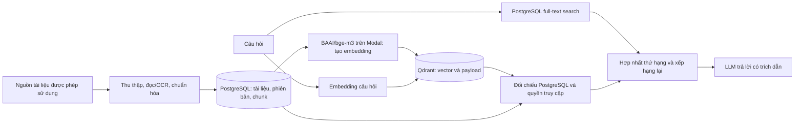

# LƯU TRỮ VÀ TRUY XUẤT VECTOR BẰNG QDRANT TRONG HỆ THỐNG HVNH HUB

*Báo cáo mô tả thiết kế và mã nguồn RAG hiện tại, cập nhật ngày 26/10/2026.*

## 1. Vai trò của Qdrant trong hệ thống

Trợ lý AI của HVNH Hub trả lời câu hỏi dựa trên tài liệu đã thu thập và lập chỉ mục. Để tìm những đoạn có **ý nghĩa gần** câu hỏi ngay cả khi cách dùng từ khác nhau, hệ thống biến mỗi đoạn văn bản thành một vector số (*embedding*) và lưu vector đó trong Qdrant. Qdrant được dùng để tìm các đoạn ứng viên theo độ tương đồng; nó không quản lý tài khoản, không chứa bản gốc PDF và không tự sinh câu trả lời. Một *point* của Qdrant gồm ID, vector và payload metadata; các point cùng cấu hình được lưu trong một *collection*. [Qdrant: Collections](https://qdrant.tech/documentation/manage-data/collections/), [Points](https://qdrant.tech/documentation/concepts/points/).

PostgreSQL giữ tài liệu, phiên bản, nội dung chunk và trạng thái có hiệu lực. Qdrant giữ vector cùng metadata để tìm nhanh. Sự phân vai này đặc biệt quan trọng vì kết quả Qdrant chỉ là **ứng viên**: trước khi chuyển sang mô hình ngôn ngữ, backend đối chiếu point với bản ghi PostgreSQL để xác nhận nội dung và quyền truy cập.



Tài liệu sinh viên chia sẻ trong **kho nhóm Học tập** là một chức năng riêng. Mã hiện tại không tự chuyển các file đó thành point của Qdrant trong RAG; báo cáo này nói về chỉ mục tài liệu của trợ lý AI.

## 2. Mô hình dữ liệu và cấu hình collection

### 2.1. Dữ liệu gốc trong PostgreSQL

- `ai_documents`: định danh tài liệu, tiêu đề, loại, năm học, cơ quan ban hành, ngày công bố, khoảng hiệu lực, phạm vi hiển thị và phiên bản hiện hành.
- `ai_document_versions`: từng lần cập nhật tài liệu, URL nguồn, nội dung đã trích xuất, hash, trạng thái `PENDING`, `PROCESSING`, `INDEXED`, `ARCHIVED` hoặc lỗi.
- `ai_document_chunks`: mỗi đoạn nhỏ bất biến của một phiên bản, nội dung, SHA-256, số thứ tự, vị trí trang/mục và `qdrant_point_id` duy nhất.

Như vậy, quan hệ là **một tài liệu → nhiều phiên bản → nhiều chunk**. Một chunk tương ứng một point Qdrant. Nội dung chuẩn để trả lời được đọc từ PostgreSQL; payload Qdrant không được coi là bản ghi có thẩm quyền.

### 2.2. Point trong Qdrant

Collection mặc định trong cấu hình là `hvnh_documents`. Khi chưa tồn tại, mã tạo collection có **vector dense 1.024 chiều** và phép đo **Cosine**; kích thước được kiểm tra lại nếu collection đã có. Đây là cấu hình tương ứng với embedding mặc định `BAAI/bge-m3`. Bộ tạo embedding trả vector đã chuẩn hóa độ dài; Qdrant so sánh vector câu hỏi với vector các chunk để tìm sự gần nhau về ngữ nghĩa. Qdrant hỗ trợ cosine và payload filter như mô tả trong [tài liệu collection](https://qdrant.tech/documentation/manage-data/collections/) và [filtering](https://qdrant.tech/documentation/search/filtering/).

Ví dụ cấu trúc một point (giá trị chỉ để minh họa):

```text
id: <qdrant_point_id của chunk>
vector: [0.012, -0.034, ...]  # đủ 1.024 số
payload:
  chunk_id: <UUID>
  document_id: <UUID>
  document_version_id: <UUID>
  title: "Thông báo xét học bổng ..."
  content: "Điều kiện xét ..."
  content_hash: <SHA-256 của content>
  document_type: "ANNOUNCEMENT"
  academic_year: "2026/2027"
  visibility: "PUBLIC"
  group_id: null
  is_current: true
  source_url: "https://..."
  page_start: 1
  page_end: 2
```

Payload thực tế còn có mã tài liệu, cơ quan ban hành, thời điểm công bố/hiệu lực, số phiên bản, tên mục, đường dẫn đề mục và vị trí chunk. Các trường được tạo **payload index** trong mã là `document_id`, `document_version_id`, `document_type`, `academic_year`, `visibility`, `group_id`, `is_current` và `published_at`; chúng phục vụ lọc theo thời gian, phiên bản và quyền. Collection đặt `on_disk_payload=True`, nghĩa là payload được cấu hình lưu trên đĩa; mã **không** thiết lập vector on-disk hay quantization riêng. [Qdrant: Payload](https://qdrant.tech/documentation/concepts/payload/).

## 3. Luồng tạo và lưu vector

1. Pipeline thu thập tài liệu từ nguồn đã cho phép, đọc văn bản hoặc OCR nếu cần, chuẩn hóa nội dung và lưu tài liệu/phiên bản vào PostgreSQL. Tài liệu trùng nội dung được nhận biết bằng SHA-256 để tránh tạo phiên bản lặp.
2. Bộ chia đoạn tách văn bản theo cấu trúc tiêu đề và ranh giới câu/đoạn. Cấu hình mặc định là khoảng **1.800 ký tự/chunk**, chồng lấn khoảng **250 ký tự** để giữ ngữ cảnh ở đoạn giáp ranh. Mỗi chunk có hash riêng, thứ tự và thông tin trang/mục nếu trích xuất được.
3. Trước khi index, pipeline kiểm tra trạng thái phiên bản, nội dung hash và tín hiệu kiểm tra an toàn. Tài liệu bị cách ly không được đưa vào Qdrant.
4. Dịch vụ embedding mặc định gọi `BAAI/bge-m3` qua Modal, theo lô mặc định 20 chunk. Nó xác minh số vector, mô hình, số chiều và độ dài vector trước khi lưu.
5. Dịch vụ index tạo/kiểm tra collection, đánh dấu các point thuộc phiên bản cũ của tài liệu là `is_current=false`, rồi `upsert` point của phiên bản mới với vector và payload. Lệnh upsert dùng `wait=True` để chờ Qdrant áp dụng thao tác.
6. Chỉ sau khi các point được ghi, PostgreSQL mới chuyển phiên bản mới sang `INDEXED`, các phiên bản trước sang `ARCHIVED`, và cập nhật `current_version_id`. Nếu có lỗi, mã rollback PostgreSQL, cố xóa point mới và khôi phục cờ hiện hành của phiên bản cũ. Do PostgreSQL và Qdrant là hai dịch vụ khác nhau, đây là cơ chế bù trừ chứ không phải một giao dịch ACID chung.

Phiên bản cũ có thể còn nằm trong Qdrant với `is_current=false` để phục vụ câu hỏi lịch sử. Việc xóa point không còn bản ghi hỗ trợ là tác vụ riêng `scripts.index prune`; chế độ mặc định chỉ thống kê, `--apply` mới thực hiện xóa. Lệnh này giữ cả chunk của phiên bản `INDEXED` lẫn `ARCHIVED`.

## 4. Luồng truy xuất khi người dùng đặt câu hỏi

Giả sử người dùng hỏi: **“Điều kiện xét học bổng năm học 2026/2027 là gì?”** Đây là ví dụ minh họa quá trình, không phải khẳng định câu trả lời cụ thể đã có trong dữ liệu thực.

1. Backend kiểm tra đầu vào, có thể viết lại câu hỏi nếu đây là lượt tiếp theo trong hội thoại, rồi suy ra năm học `2026/2027` và ý định tìm thông tin học bổng.
2. Câu hỏi được đưa qua cùng hệ embedding để tạo **một vector 1.024 chiều**. Hệ thống có cache embedding trong tiến trình và có tùy chọn cache chia sẻ qua Redis nhằm tránh tính lại cho câu hỏi trùng.
3. Backend gọi `query_points` trên collection Qdrant với vector câu hỏi. Filter ưu tiên năm học đã hỏi; nếu không hỏi lịch sử thì chỉ lấy `is_current=true`. Filter quyền cho phép `PUBLIC`, thêm `AUTHENTICATED` nếu đã xác thực, và chỉ thêm `GROUP` khi người hỏi thuộc nhóm tương ứng. Mặc định lấy tối đa **20 ứng viên vector**, ngưỡng lấy ứng viên mặc định **0,30**. Qdrant trả point, score và payload, **không trả lại vector** để giảm dữ liệu truyền (`with_vectors=False`).
4. Đồng thời, PostgreSQL chạy **full-text search** độc lập để bắt cụm từ, tên văn bản, mã và con số mà truy xuất ngữ nghĩa có thể bỏ sót. Hai nhánh chạy song song, không cộng tuần tự thời gian chờ mạng.
5. Với kết quả Qdrant, backend tra các chunk tương ứng trong PostgreSQL và kiểm tra ID point, ID tài liệu/phiên bản, hash nội dung, trạng thái tài liệu, nguồn hợp lệ, thời hạn hiệu lực, năm học và quyền người hỏi. Ứng viên sai lệch hoặc đã bị xóa/bị cách ly bị loại ngay cả khi Qdrant trả score cao.
6. Kết quả vector và từ khóa được hợp nhất bằng **Reciprocal Rank Fusion (RRF)**, sau đó xếp hạng lại bằng bộ quy tắc xác định dựa trên tiêu đề, thực thể, nội dung, năm học và loại câu hỏi. Mã hiện tại dùng `HeuristicReranker`; không có một model reranker riêng trong luồng mặc định.
7. Bộ lọc cuối giới hạn số chunk từ cùng một tài liệu để tăng đa dạng nguồn, và mặc định lấy **5 đoạn** làm bằng chứng. Một số dạng câu hỏi như điều kiện học bổng hoặc hướng dẫn chi tiết có giới hạn đa dạng được nới hơn để giữ đủ bảng/điều khoản liên quan. Ngưỡng score vector thông thường ở bước cuối mặc định là **0,45**; nhánh từ khóa được xử lý theo logic hợp nhất riêng.
8. Các đoạn đã qua kiểm tra được gửi cho LLM để sinh câu trả lời có ký hiệu trích dẫn `[1]`, `[2]`... Backend kiểm tra trích dẫn và lưu snapshot nguồn trong PostgreSQL. Nếu không có bằng chứng phù hợp, hệ thống trả lời rằng chưa tìm thấy thông tin thay vì dựng một câu trả lời không có nguồn.

**Cần phân biệt:** score Cosine là mức gần nhau của vector trong mô hình biểu diễn, không phải xác suất câu trả lời đúng. Độ đúng còn phụ thuộc nguồn đầu vào, chia đoạn, phiên bản, bộ lọc, xếp hạng và kiểm tra nội dung sau truy xuất.

## 5. Kiểm soát phiên bản, quyền và tính đúng đắn

Payload Qdrant hỗ trợ **lọc sớm** để giảm số point cần xét, nhưng không là lớp phân quyền cuối. PostgreSQL kiểm tra lại tài liệu chưa bị xóa, nguồn còn được phép sử dụng, phiên bản phù hợp, khoảng hiệu lực, phạm vi `PUBLIC/AUTHENTICATED/GROUP`, quan hệ nhóm, trạng thái `INDEXED/ARCHIVED` và SHA-256 của chunk. Vì vậy, thay đổi quyền hoặc xóa tài liệu trong PostgreSQL có thể khiến point cũ bị loại khỏi câu trả lời trước khi quá trình đồng bộ/xóa point Qdrant hoàn tất.

Phiên bản mới chỉ được coi là hiện hành sau khi lập chỉ mục thành công. Câu hỏi lịch sử có thể xét các phiên bản `ARCHIVED`, còn câu hỏi thông thường ưu tiên phiên bản hiện hành. Cơ chế này tránh lấy nhầm quy định cũ cho câu hỏi về hiện tại, nhưng vẫn cho phép tra cứu biến đổi qua thời gian khi người dùng hỏi rõ.

Qdrant được kết nối bằng `AsyncQdrantClient`; URL, API key, timeout và số lần retry đọc từ cấu hình backend. Retry chỉ áp dụng cho thao tác có thể gọi lại an toàn, theo cấp số nhân. Thông tin kết nối Qdrant và Modal phải nằm ở backend, không đưa vào Web/Flutter. Báo cáo này không xác nhận trạng thái API key, TLS hay snapshot thực tế của cụm Qdrant đang triển khai.

## 6. Vận hành, đo lường và giới hạn

Mã có các lệnh `scripts.index info`, `validate`, `run`, `history`, `prune` và `sync-metadata`. `validate` đối chiếu số chunk phiên bản hiện hành trong PostgreSQL với số point hiện hành trong Qdrant, kiểm tra số chiều, payload index và một point mẫu. Khi chạy thử truy xuất, log `rag_retrieval_completed` tách thời gian `embedding_ms`, `qdrant_ms`, `lexical_ms`, `verification_ms`, tổng thời gian và số ứng viên. Các chỉ số này giúp xác định chậm ở tạo vector, Qdrant hay xác minh PostgreSQL thay vì quy mọi độ trễ cho vector database.

Với vector float 32-bit dài 1.024 chiều, **phần vector thô** có kích thước lý thuyết khoảng 4 KiB/point; đây chỉ là phép tính `1.024 × 4 byte`, chưa tính payload, chỉ mục và chi phí lưu trữ của Qdrant. Không nên dùng con số này làm dung lượng triển khai thực tế. Việc đặt `on_disk_payload=True` giảm áp lực giữ payload lớn trong RAM, nhưng các trường payload được index và cấu trúc tìm kiếm vẫn cần tài nguyên. [Qdrant: Storage](https://qdrant.tech/documentation/manage-data/storage/).

Các việc nên kiểm tra khi vận hành production: sao lưu/snapshot collection, theo dõi sự lệch số point với chunk PostgreSQL, chạy `validate` sau đợt index, chỉ dùng `prune --apply` sau khi xem kết quả thống kê, và đo Recall/Precision trên bộ câu hỏi thực. Đây là **khuyến nghị vận hành**, không phải bằng chứng các chính sách snapshot đã được bật. Qdrant cung cấp cơ chế snapshot để sao lưu nhưng cấu hình sao lưu cụ thể phụ thuộc nơi triển khai. [Qdrant: Snapshots](https://qdrant.tech/documentation/operations/snapshots/).

## 7. Kết luận

Trong HVNH Hub, Qdrant đảm nhiệm **lưu vector chunk và tìm ứng viên theo ngữ nghĩa**. BGE-M3 tạo vector, PostgreSQL là nguồn dữ liệu chuẩn và nơi thực thi xác minh sau truy xuất, full-text search bổ sung khả năng tìm đúng từ khóa, còn LLM chỉ nhận các bằng chứng đã được chọn và kiểm tra. Thiết kế này hỗ trợ tài liệu có nhiều phiên bản, kiểm soát quyền và trích dẫn nguồn rõ ràng; chất lượng cuối cùng phải được đánh giá bằng dữ liệu câu hỏi thực, không chỉ bằng score của Qdrant.

## Tài liệu đối chiếu

- Mã nguồn dự án: `RAG/app/knowledge/chunking.py`, `RAG/app/knowledge/indexing.py`, `RAG/app/knowledge/indexer/qdrant.py`, `RAG/app/rag/embeddings.py`, `RAG/app/rag/retriever.py`, `RAG/app/rag/service.py`, `RAG/app/models/rag.py`, `RAG/scripts/index.py`.
- [Qdrant: Collections](https://qdrant.tech/documentation/manage-data/collections/).
- [Qdrant: Points](https://qdrant.tech/documentation/concepts/points/).
- [Qdrant: Payload](https://qdrant.tech/documentation/concepts/payload/).
- [Qdrant: Filtering](https://qdrant.tech/documentation/search/filtering/).
- [Qdrant: Snapshots](https://qdrant.tech/documentation/operations/snapshots/).
