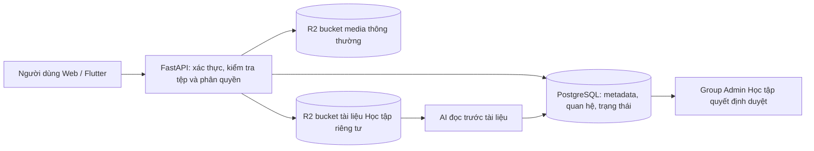

# THIẾT KẾ LƯU TRỮ DỮ LIỆU TRÊN CLOUDFLARE R2 TRONG HVNH HUB

*Báo cáo mô tả mã nguồn hiện tại, cập nhật ngày 26/10/2026.*

## 1. Mục tiêu và phạm vi

HVNH Hub có hai loại dữ liệu chính: dữ liệu quan hệ như tài khoản, bài viết, quyền truy cập và trạng thái duyệt; dữ liệu nhị phân như ảnh, video, âm thanh và tài liệu. Hệ thống dùng PostgreSQL để quản lý dữ liệu quan hệ và thông tin mô tả tệp, còn Cloudflare R2 để giữ nội dung nhị phân. Cách tách này giúp truy vấn nghiệp vụ theo ID và trạng thái trong cơ sở dữ liệu mà không phải đưa toàn bộ tệp vào một hàng SQL.

Cloudflare R2 là dịch vụ lưu trữ đối tượng có giao diện tương thích S3. Trong dự án, FastAPI kết nối R2 qua `boto3`, còn Next.js và Flutter gọi API chung của FastAPI. R2 không thay thế PostgreSQL; một đối tượng R2 được nhận diện bằng **bucket + object key**, trong khi quyền sở hữu và điều kiện hiển thị do backend và cơ sở dữ liệu quyết định. [Tài liệu R2](https://developers.cloudflare.com/r2/how-r2-works/).

Phạm vi báo cáo gồm avatar, ảnh bìa, tệp bài viết, ảnh bình luận, tệp tin nhắn và kho tài liệu nhóm Học tập. Bộ tài liệu do pipeline RAG thu thập từ nguồn ngoài là một luồng dữ liệu khác; mã hiện tại **không tự đưa tài liệu sinh viên trong kho Học tập vào chỉ mục RAG**.

## 2. Kiến trúc tổng thể



Backend là điểm kiểm soát nghiệp vụ. Trong luồng upload đang được Web và Flutter sử dụng, client gửi tệp tới FastAPI; FastAPI xác minh định dạng, dung lượng và chủ sở hữu, rồi ghi đối tượng lên R2. Khi trả dữ liệu cho giao diện, backend lấy metadata từ PostgreSQL và tạo URL tải có chữ ký cho đối tượng tương ứng. Với kho Học tập, backend kiểm tra tư cách thành viên và trạng thái duyệt *trước khi* cấp URL tải.

Hệ thống cũng có API **presigned PUT** cho avatar: backend tạo bản ghi `PENDING` và URL upload ngắn hạn; sau khi client tải tệp trực tiếp lên R2, API `complete` dùng `head_object` đối chiếu dung lượng và MIME trước khi chuyển bản ghi sang `READY`. Đây là một luồng được hỗ trợ trong backend; không nên nhầm nó với luồng upload qua backend mà giao diện đang dùng.

## 3. Phân loại dữ liệu và bucket

| Nhóm dữ liệu | Nơi chứa nội dung | Metadata chính | Kiểm soát truy cập hiện có |
| --- | --- | --- | --- |
| Avatar, ảnh bìa, ảnh/video/tệp bài viết, ảnh bình luận, tệp tin nhắn | `R2_BUCKET_NAME` | `media_files` và các bảng tham chiếu của hồ sơ/bài viết/bình luận/tin nhắn | Backend xác thực người upload, kiểm tra tệp thuộc chủ sở hữu và ở trạng thái `READY`; API trả URL đọc có chữ ký |
| Bộ tài liệu nhóm Học tập | `R2_STUDY_BUCKET_NAME` | `study_documents`, `study_document_files`, dữ liệu đánh giá và báo cáo | Bucket phải khác bucket media; backend kiểm tra đúng nhóm, thành viên, tác giả, admin và trạng thái duyệt trước khi cấp quyền tải |

Tên `R2_BUCKET_NAME` trong mã chỉ xác định bucket media thông thường. **Mã hiện tại vẫn cấp URL GET có chữ ký cho media**, nên không thể dựa vào mã để khẳng định bucket đó đã bật truy cập công khai trên Cloudflare. Ngược lại, thiết kế kho Học tập yêu cầu bucket riêng tư, không gắn public domain và không mở đọc ẩn danh; cấu hình thực tế trong Cloudflare Dashboard cần được kiểm tra riêng. Theo tài liệu Cloudflare, bucket R2 mặc định là riêng tư cho đến khi chủ tài khoản chủ động bật public access. [Cloudflare: Public buckets](https://developers.cloudflare.com/r2/buckets/public-buckets/).

## 4. Thiết kế định danh và metadata

### 4.1. Media thông thường

`media_files` lưu `id`, `owner_id`, `bucket`, `object_key`, tên gốc, MIME, dung lượng, SHA-256 (với luồng upload qua backend), kích thước ảnh nếu có, trạng thái `PENDING/READY/FAILED/DELETED` và các mốc thời gian. Cặp `(bucket, object_key)` có ràng buộc duy nhất. Bài viết, bình luận, hồ sơ và tin nhắn chỉ liên kết bằng ID media; chúng không lưu tệp nhị phân trong PostgreSQL.

Object key được tạo ở backend theo mẫu:

```text
{loại}/users/{user_id}/{mục_đích}/{media_id}.{đuôi_tệp}
```

Ví dụ minh họa: `images/users/<user-id>/avatars/<media-id>.webp`. Các tiền tố `images`, `short-videos`, `audio`, `files` và mục đích `avatars`, `covers`, `posts`, `comments`, `messages` giúp tổ chức đối tượng. Tên gốc chỉ nằm trong metadata; ID ngẫu nhiên trong key giúp tránh trùng tên khi nhiều người tải tệp cùng tên.

### 4.2. Tài liệu Học tập

`study_documents` mô tả một **bộ tài liệu**: nhóm, ngành, môn, loại tài liệu, người chia sẻ, tiêu đề, mô tả, số tệp, tổng dung lượng, trạng thái `PENDING/APPROVED/REJECTED`, người và thời điểm duyệt, lý do từ chối. `study_document_files` chứa từng file của bộ tài liệu: `document_id`, `r2_object_key`, tên gốc, MIME, phần mở rộng, dung lượng, SHA-256 và thời điểm xóa. Khóa có mẫu:

```text
study-groups/{group_id}/documents/{document_id}/{file_id}.{đuôi_tệp}
```

Vì một bộ có nhiều file, mô hình hai bảng cho phép duyệt, hiển thị và tải **trọn bộ** mà vẫn truy xuất từng file để xem trước. Metadata này cũng là căn cứ để AI đọc trước nội dung và để admin quyết định; dữ liệu đánh giá AI lưu riêng trong `study_document_ai_assessments`.

## 5. Luồng upload và đọc media thông thường

1. Người dùng đã đăng nhập chọn tệp trên Web hoặc Flutter. Client gửi multipart tới endpoint phù hợp như `/media/upload/avatar`, `/cover`, `/post`, `/comment`, `/message`.
2. Backend giới hạn dung lượng và đối chiếu MIME với nội dung thực: ảnh được Pillow kiểm tra; các định dạng khác được kiểm tra chữ ký tệp. Giới hạn cấu hình hiện tại: avatar/ảnh bìa và ảnh bình luận 5 MiB, video ngắn 100 MiB, âm thanh và tệp thường 25 MiB.
3. Backend tạo UUID, object key và checksum khi áp dụng, dùng `put_object` ghi vào bucket media. Nếu R2 báo lỗi, API trả lỗi upload; nếu thành công, metadata ở trạng thái `READY` được commit vào PostgreSQL và API trả `media_id`.
4. Khi người dùng đăng bài, gửi tin nhắn hoặc đổi avatar, API nhận `media_id` và kiểm tra media đó do đúng người dùng tải lên, đã `READY`, đúng loại tệp. Bảng nghiệp vụ lưu quan hệ với `media_id`.
5. Khi lấy bài viết/hồ sơ/tin nhắn, backend tạo presigned GET URL theo `bucket` và `object_key` đã lưu. URL được gửi cho giao diện để trình duyệt hoặc ứng dụng tải nội dung trực tiếp từ R2. Thời hạn mặc định trong cấu hình là **900 giây**.

URL có chữ ký là một quyền truy cập tạm thời: ai có URL có thể dùng nó cho thao tác đã ký cho tới khi hết hạn. Vì vậy, URL không được xem là bí mật dài hạn và không nên lưu cố định trong database hay nhúng vào báo cáo công khai. [Cloudflare: Presigned URLs](https://developers.cloudflare.com/r2/api/s3/presigned-urls/).

## 6. Luồng tài liệu Học tập riêng tư

1. Backend chỉ chấp nhận yêu cầu từ thành viên nhóm có slug `hoc-tap`; Super Admin không được dùng quyền tổng để đọc kho như thành viên. Người chia sẻ chọn ngành, môn, loại tài liệu, tiêu đề và 1–10 file; tổng dung lượng tối đa **50 MiB**.
2. Backend xác minh ngành và quan hệ môn–ngành, làm sạch tên file, kiểm tra phần mở rộng, MIME và cấu trúc thực (chẳng hạn header PDF hoặc cấu trúc OOXML), tính SHA-256 và từ chối hai file trùng nội dung trong cùng một lượt chia sẻ.
3. Backend dùng `upload_fileobj` ghi từng file vào bucket `R2_STUDY_BUCKET_NAME`, sau đó tạo bản ghi bộ tài liệu và file trong PostgreSQL. Nếu upload hoặc ghi DB thất bại, mã cố gắng xóa các object đã bắt đầu tải để tránh tệp mồ côi.
4. Với sinh viên, trạng thái ban đầu là `PENDING`. Nếu bật AI Moderation, một công việc đánh giá được xếp hàng; AI đọc bản sao file từ bucket riêng để trích xuất và đưa ra **đề xuất**, còn Group Admin Học tập đưa ra quyết định cuối cùng. Tài liệu do chính Group Admin Học tập chia sẻ được đánh dấu `APPROVED` ngay trong mã hiện tại.
5. File chưa duyệt chỉ tác giả và admin đúng nhóm được xem theo các điều kiện API; thành viên khác chỉ xem/tải bộ đã `APPROVED`. API kiểm tra quyền rồi cấp presigned GET URL tối đa **300 giây**, bất kể thời hạn media thông thường lớn hơn.
6. PDF và ảnh có thể mở qua URL xem trước. `.docx` và `.xlsx` được backend tải tạm từ R2 để trích nội dung phục vụ preview; một số định dạng Office cũ phải tải về. Tải trọn bộ khiến backend đọc các file từ R2, đóng gói ZIP tạm thời và stream ZIP cho người dùng.
7. Tác giả có thể xóa bộ tài liệu của mình. Khi admin từ chối, metadata và lý do vẫn được lưu cho tác giả nhưng mã cố xóa nội dung nhị phân; endpoint cleanup hỗ trợ thử lại các lần xóa R2 thất bại. Trường hợp admin gỡ tài liệu bị tố cáo cũng có đường xóa object tương ứng.

**Ví dụ:** Sinh viên chia sẻ bộ “Đề ôn tập môn Cơ sở lập trình” gồm `de.pdf` và `loi-giai.docx`. Hai file nằm dưới cùng `document_id` trong bucket Học tập; `study_documents` lưu môn và trạng thái `PENDING`, còn `study_document_files` lưu hai key riêng. AI đọc từ bucket và lưu đề xuất. Sau khi admin duyệt, thành viên nhóm yêu cầu xem `de.pdf`; API xác minh quyền và cấp URL đọc có hạn 5 phút. Nếu cần cả hai file, API tạo một ZIP để tải trọn bộ.

## 7. Bảo mật, tính nhất quán và vận hành

Các biến `R2_ACCOUNT_ID`, `R2_ACCESS_KEY_ID`, `R2_SECRET_ACCESS_KEY`, `R2_BUCKET_NAME` và `R2_STUDY_BUCKET_NAME` được backend đọc từ môi trường. Cùng một cặp khóa R2 có thể được dùng cho hai bucket nếu khóa được cấp quyền phù hợp; mã không yêu cầu một bộ khóa riêng cho bucket Học tập. Khóa bí mật chỉ ở backend, không đưa vào `NEXT_PUBLIC_*`, ứng dụng Flutter hoặc Git. Client R2 của backend dùng endpoint tài khoản Cloudflare, region `auto` và chữ ký S3 v4.

Phân quyền nằm ở API chứ không chỉ ở việc ẩn nút trên giao diện. Backend kiểm tra sở hữu media trước khi gắn vào bài viết/tin nhắn, kiểm tra thành viên và trạng thái duyệt trước khi phát URL tài liệu. Bucket Học tập phải giữ chế độ riêng tư trên Cloudflare; nếu bật public domain hoặc `r2.dev`, người biết object key có thể đi vòng qua kiểm tra của ứng dụng. URL ký chỉ dùng endpoint S3 API của R2; theo Cloudflare, không dùng URL ký trên custom domain. [Cloudflare: Presigned URLs](https://developers.cloudflare.com/r2/api/s3/presigned-urls/).

R2 và PostgreSQL không có một giao dịch ACID chung. Mã kho Học tập đã cố dọn object khi upload/DB lỗi và có cơ chế cleanup cho file bị từ chối. Đây là cơ chế bù trừ, không bảo đảm tuyệt đối rằng mọi tệp mồ côi sẽ được phát hiện sau lỗi tiến trình hoặc mất điện. Nên bổ sung tác vụ định kỳ đối soát object key với metadata, cảnh báo lỗi upload/xóa, kiểm tra backup, lifecycle và versioning theo chính sách vận hành. Đây là **đề xuất cải tiến**, không phải chức năng đã xác nhận đang bật.

Nếu Web/Flutter Web tải trực tiếp từ URL ký, CORS của bucket cần cho phép origin và phương thức phù hợp; đây là cấu hình trên Cloudflare, không suy ra được chỉ từ repository. [Cloudflare: Configure CORS](https://developers.cloudflare.com/r2/buckets/cors/).

## 8. Đánh giá thiết kế

Thiết kế hiện tại phân tách rõ nội dung nhị phân với dữ liệu nghiệp vụ, tái sử dụng một backend cho Web và Flutter, tổ chức object bằng khóa có cấu trúc, và dùng URL tạm thời thay cho việc phát khóa truy cập R2 cho client. Kho tài liệu Học tập có lớp cách ly bucket và quy tắc duyệt chặt hơn media thông thường. Điểm cần vận hành cẩn thận là cấu hình quyền bucket/CORS, thời hạn URL, chi phí xử lý tệp qua backend, và đối soát các object mồ côi sau lỗi liên dịch vụ. Báo cáo này mô tả **mã nguồn**, không xác nhận trạng thái bucket, quyền API token hay chính sách backup đang được bật trong tài khoản Cloudflare thực tế.

## Tài liệu đối chiếu

- Mã nguồn dự án: `backend/src/services/storage_service.py`, `backend/src/api/endpoints/media.py`, `backend/src/db/models/media.py`.
- Mã nguồn kho Học tập: `backend/src/services/study_document_service.py`, `backend/src/services/study_document_ai.py`, `backend/src/api/endpoints/study_documents.py`, migration `20261015_0025_study_documents_rag_usage.py`.
- [Cloudflare R2: How R2 works](https://developers.cloudflare.com/r2/how-r2-works/).
- [Cloudflare R2: Presigned URLs](https://developers.cloudflare.com/r2/api/s3/presigned-urls/).
- [Cloudflare R2: Public buckets](https://developers.cloudflare.com/r2/buckets/public-buckets/).
- [Cloudflare R2: Configure CORS](https://developers.cloudflare.com/r2/buckets/cors/).
