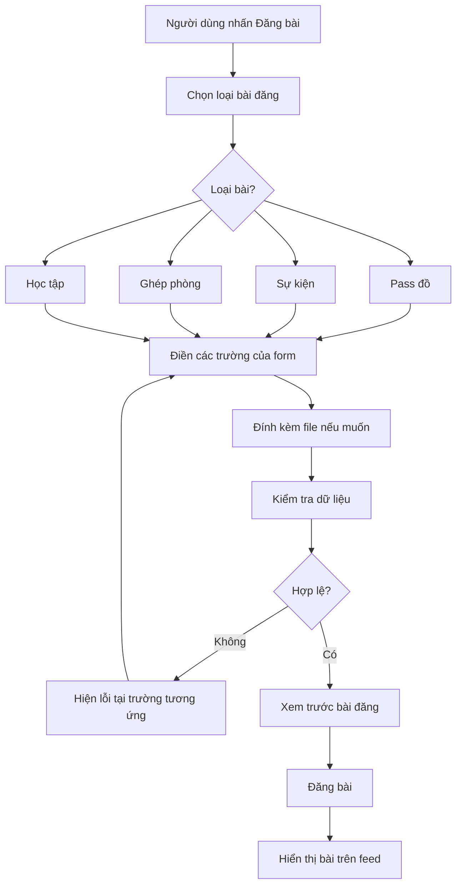

# Đặc tả UI/UX – Hệ thống bài đăng trong hội nhóm

> Phiên bản: 1.0 (bản đề xuất)  
> Mục tiêu: Mô tả rõ luồng đăng bài, các trường dữ liệu, quy tắc bắt buộc và gợi ý giao diện cho 4 loại bài đăng: **Pass đồ**, **Sự kiện**, **Ghép phòng**, **Học tập**.

## 1. Tổng quan

Ứng dụng cho phép thành viên hội nhóm tạo và xem bài đăng theo 4 loại nội dung. Mỗi loại có form riêng, nhưng sử dụng **một luồng tạo bài thống nhất**. Tất cả loại bài đều hỗ trợ đính kèm **ảnh, video và tài liệu** theo lựa chọn của người đăng; file đính kèm mặc định **không bắt buộc**, ngoại trừ khi sản phẩm quyết định dùng file thay cho nội dung văn bản bắt buộc ở nhóm Học tập.

### Nguyên tắc

- Chỉ các trường được đánh dấu **Tùy chọn** mới có thể bỏ trống.
- Trường bắt buộc phải được kiểm tra trước khi cho phép đăng; chuỗi chỉ gồm khoảng trắng được xem là trống.
- Hiển thị dấu `*` bên cạnh nhãn của trường bắt buộc; trường tùy chọn hiển thị `(Tùy chọn)`.
- Người dùng chọn loại bài đăng trước; form tự động đổi theo loại.
- Không bắt người dùng nhập những trường không thuộc loại bài đang chọn.
- Nên có bước **Xem trước** (hoặc bản xem trước ngay trên form) và thông báo lỗi rõ ràng.

## 2. Chi tiết form từng loại bài

### 2.1. Pass đồ

**Mục đích:** Đăng bán, nhượng lại hoặc trao đổi vật phẩm.

| Trường | Kiểu UI gợi ý | Bắt buộc | Ghi chú |
|---|---|---|---|
| Tên vật phẩm | Text input | Có | Ví dụ: Bàn học gỗ, Bàn phím Keychron K6 |
| Thông tin chi tiết | Textarea | Không | Tình trạng, đặc điểm, lý do pass... |
| Giá cả | Numeric input (VND) | Có | Cho phép `0` nếu muốn tặng miễn phí; không chấp nhận số âm |
| Vị trí | Chọn vị trí / Text input | Có | Khu vực giao nhận; không yêu cầu địa chỉ nhà chính xác |
| Ảnh / Video / Tài liệu | Media picker | Không | Có thể đính kèm nhiều file |

**Đề xuất mở rộng:** Trạng thái vật phẩm (`Mới`, `Đã sử dụng`) dưới dạng lựa chọn nhanh, tùy chọn ở MVP.

### 2.2. Sự kiện

**Mục đích:** Thông báo, tổ chức hoạt động, workshop, buổi gặp mặt.

| Trường | Kiểu UI gợi ý | Bắt buộc | Ghi chú |
|---|---|---|---|
| Tên sự kiện | Text input | **Có (đề xuất bổ sung)** | Giúp hiển thị tiêu đề trên feed và tìm kiếm |
| Mô tả sự kiện | Textarea | Có | Nội dung, hoạt động, thông tin tham gia |
| Thời gian | Date & Time picker | Có | Tối thiểu có ngày và giờ bắt đầu; khuyến nghị thêm thời gian kết thúc |
| Vị trí | Chọn vị trí / Text input | Có | Địa điểm tổ chức; có thể mở rộng sự kiện trực tuyến |
| Ảnh / Video / Tài liệu | Media picker | Không | Poster, lịch trình, tài liệu... |

**Đề xuất mở rộng:** Thời gian kết thúc, hình thức (`Trực tiếp` / `Trực tuyến`), link tham gia; chỉ bổ sung khi thực sự cần.

### 2.3. Ghép phòng

**Mục đích:** Tìm người ở ghép hoặc tìm phòng.

| Trường | Kiểu UI gợi ý | Bắt buộc | Ghi chú |
|---|---|---|---|
| Thông tin | Textarea | Có | Mô tả phòng, nhu cầu, số người, tiện ích... |
| Giá cả | Numeric input (VND) | Không | Nếu nhập phải là số không âm; nên ghi rõ đơn vị đ/tháng |
| Vị trí | Chọn vị trí / Text input | Có | Khu vực phòng / khu vực muốn tìm |
| Ảnh / Video / Tài liệu | Media picker | Không | Ảnh phòng, video tham quan, tài liệu... |

**Đề xuất mở rộng:** Lựa chọn `Tìm phòng` / `Tìm người ở ghép` để dễ phân loại; có thể thêm tiêu đề tự sinh từ nội dung và khu vực, không cần bắt nhập thêm ở MVP.

### 2.4. Học tập

**Mục đích:** Chia sẻ tài liệu, bài học, kinh nghiệm hoặc đặt câu hỏi theo môn học.

| Trường | Kiểu UI gợi ý | Bắt buộc | Ghi chú |
|---|---|---|---|
| Tên môn | Text input / Autocomplete | Có | Ví dụ: Giải tích 1, Cấu trúc dữ liệu |
| Tài liệu | Textarea | Có | Theo yêu cầu gốc: trường nội dung/tài liệu không được trống |
| Ảnh / Video / Tài liệu đính kèm | Media picker | Không | Có thể bổ sung PDF, DOCX, ảnh ghi chú, video... |

**Làm rõ UX quan trọng:** Trường **Tài liệu** trong form được hiểu là **nội dung/mô tả bằng văn bản**, không đồng nghĩa với file bắt buộc. Nếu muốn cho phép người dùng chỉ tải file mà không nhập mô tả, cần thay quy tắc thành: **có ít nhất một trong hai: nội dung văn bản hoặc file tài liệu**. Đây là **phương án đề xuất**, chưa phải yêu cầu đã chốt.

## 3. Luồng UX tạo bài đăng



### Hành vi giao diện

1. **Chọn loại bài:** Hiển thị 4 thẻ có icon và tên: Pass đồ, Sự kiện, Ghép phòng, Học tập.
2. **Nhập thông tin:** Chỉ hiện trường thuộc loại đã chọn. Có nhãn rõ ràng, ví dụ gợi ý (placeholder), dấu `*` cho trường bắt buộc.
3. **Đính kèm:** Dùng chung một thành phần cho ảnh, video, tài liệu; cho phép xem danh sách file đã chọn và xóa file trước khi đăng.
4. **Kiểm tra:** Nếu thiếu trường bắt buộc, đánh dấu ngay dưới trường, cuộn tới lỗi đầu tiên; không xóa nội dung đã nhập.
5. **Xem trước:** Hiển thị bài gần giống thẻ bài trên feed, gồm tên người đăng, loại bài, nội dung và media.
6. **Đăng:** Hiện trạng thái đang tải; ngăn gửi trùng; sau khi thành công điều hướng về bài mới hoặc feed.

### Wireframe dạng văn bản

```text
┌───────────────────────────────────────┐
│  ←              Tạo bài đăng          │
├───────────────────────────────────────┤
│  Chọn loại bài                        │
│  [Pass đồ]  [Sự kiện]                 │
│  [Ghép phòng] [Học tập]               │
├───────────────────────────────────────┤
│  Tên vật phẩm *                       │
│  [_______________________________]    │
│  Thông tin chi tiết (Tùy chọn)        │
│  [_______________________________]    │
│  [_______________________________]    │
│  Giá cả *                             │
│  [____________________________] VND   │
│  Vị trí *                             │
│  [_______________________________]    │
│                                       │
│  Đính kèm (Tùy chọn)                  │
│  [+ Ảnh] [+ Video] [+ Tài liệu]       │
│                                       │
│        [ Xem trước ] [ Đăng bài ]    │
└───────────────────────────────────────┘
```

*Ví dụ wireframe trên dùng form Pass đồ; các trường thay đổi khi chọn loại khác.*

## 4. Gợi ý thiết kế feed và bộ lọc

- Feed chung hiển thị thẻ bài có **nhãn loại bài** và thông tin nổi bật theo từng loại.
- Thanh lọc nhanh: `Tất cả | Pass đồ | Sự kiện | Ghép phòng | Học tập`.
- **Pass đồ:** Ưu tiên ảnh đại diện, tên vật phẩm, giá, khu vực.
- **Sự kiện:** Ưu tiên tên, thời gian, địa điểm và poster nếu có.
- **Ghép phòng:** Ưu tiên thông tin ngắn, khu vực, giá/tháng nếu có.
- **Học tập:** Ưu tiên tên môn, trích đoạn nội dung và số lượng tài liệu đính kèm.
- Có thể bổ sung lọc theo giá, ngày, khu vực, môn học sau khi hoàn thành MVP.

## 5. Quy tắc validation và dữ liệu

### 5.1. Validation phía ứng dụng và server

- Validate **cả client và server**; không chỉ dựa vào dấu `*` ở UI.
- Các chuỗi bắt buộc phải có ký tự có nghĩa sau khi `trim`.
- Giá: parse thành số nguyên VND, không âm. Giá ở Pass đồ là bắt buộc; Ghép phòng có thể không nhập.
- Thời gian sự kiện: bắt buộc là ngày giờ hợp lệ; nếu có giờ kết thúc thì phải sau giờ bắt đầu.
- Vị trí: bắt buộc có tên khu vực/địa điểm, nhưng không nên bắt buộc cung cấp tọa độ chính xác.
- File: kiểm tra loại, dung lượng, số lượng ở cả client/server; các giới hạn cụ thể cần chốt theo hạ tầng.
- Nội dung nhập vào phải được xử lý an toàn khi hiển thị; hạn chế spam và file độc hại.

### 5.2. Phân biệt NOT NULL và trường không áp dụng

Yêu cầu nghiệp vụ **bắt buộc nhập** không có nghĩa tất cả cột trong một bảng chung phải khai báo SQL `NOT NULL`. Ví dụ, bài Sự kiện không có trường `price`, còn bài Ghép phòng được phép bỏ giá.

**Gợi ý mô hình:**

- `posts`: thông tin chung (`id`, `author_id`, `group_id`, `type`, `created_at`, `status`...).
- `pass_item_details`: `post_id`, `item_name NOT NULL`, `detail NULL`, `price NOT NULL`, `location NOT NULL`.
- `event_details`: `post_id`, `event_name NOT NULL` (đề xuất), `description NOT NULL`, `start_at NOT NULL`, `location NOT NULL`.
- `roommate_details`: `post_id`, `info NOT NULL`, `price NULL`, `location NOT NULL`.
- `study_details`: `post_id`, `subject_name NOT NULL`, `document_content NOT NULL` theo yêu cầu gốc.
- `post_attachments`: `id`, `post_id`, `file_type`, `file_url`, `file_name`, `sort_order`...; mỗi bài có **0..N** file.

Có thể triển khai bằng bảng riêng như trên hoặc bằng JSON có schema validation theo `type`. Bảng riêng dễ thiết lập ràng buộc dữ liệu ở DB hơn.

## 6. Phạm vi MVP và đề xuất cải tiến

| Hạng mục | Mức độ | Lý do |
|---|---|---|
| 4 loại bài đăng và form động | MVP | Chức năng cốt lõi |
| Validation trường bắt buộc | MVP | Đảm bảo dữ liệu hợp lệ |
| Ảnh / Video / Tài liệu tùy chọn | MVP | Yêu cầu chung cho mọi loại |
| Feed có nhãn và lọc theo loại | MVP | Giúp tìm nội dung nhanh |
| Xem trước và thông báo lỗi rõ ràng | MVP | Giảm đăng sai thông tin |
| Tên sự kiện | Khuyến nghị MVP | Cần tiêu đề dễ nhận diện |
| Tìm phòng / Tìm người ở ghép | Khuyến nghị MVP | Giúp phân loại đúng nhu cầu |
| Tình trạng vật phẩm | Giai đoạn sau | Hỗ trợ người mua đánh giá |
| Thời gian kết thúc sự kiện | Giai đoạn sau | Hữu ích nhưng không phải yêu cầu gốc |
| Bộ lọc nâng cao, gợi ý môn học | Giai đoạn sau | Tối ưu tìm kiếm |

## 7. Các quyết định cần chốt trước khi triển khai

1. **Cấu trúc hội nhóm:** 4 loại bài đăng nằm **trong cùng một hội nhóm**, hay mỗi loại tương ứng với **một loại hội nhóm riêng**? Tài liệu hiện giả định một hội nhóm có thể chứa cả 4 loại bài, nhưng cần xác nhận.
2. **Học tập:** Trường `Tài liệu` bắt buộc là văn bản, hay chỉ cần **văn bản hoặc ít nhất một file**?
3. **Sự kiện:** Có bắt buộc `Tên sự kiện` theo đề xuất không? Thời gian là một mốc bắt đầu hay cả khoảng bắt đầu–kết thúc?
4. **Giá:** Có cho phép `0 VND` với Pass đồ để biểu thị tặng miễn phí không?
5. **Đính kèm:** Giới hạn dung lượng, số lượng, định dạng file; quyền xem/tải tài liệu.
6. **Vị trí:** Cho nhập tên khu vực, chọn địa điểm trên bản đồ, hay hỗ trợ cả hai?

## 8. Tiêu chí nghiệm thu cơ bản

- Người dùng có thể chọn một trong 4 loại và nhìn thấy đúng các trường của loại đó.
- Không thể đăng nếu thiếu bất kỳ trường bắt buộc nào theo cấu hình đã chốt.
- Có thể bỏ trống các trường được ghi `(Tùy chọn)`.
- Mỗi loại bài có thể được đăng **không kèm file** hoặc có ảnh/video/tài liệu đính kèm.
- Bài đăng hiển thị đúng nhãn loại và các thông tin quan trọng trên feed.
- Khi nhập sai, hệ thống hiển thị lỗi rõ ràng và giữ nguyên dữ liệu đã nhập.
- Server kiểm tra dữ liệu độc lập với ứng dụng.

---

**Ghi chú:** Tài liệu phân biệt rõ **yêu cầu ban đầu** và **đề xuất cải tiến**. Những điểm tại Mục 7 cần được xác nhận trước khi khóa thiết kế UI/UX và database.
