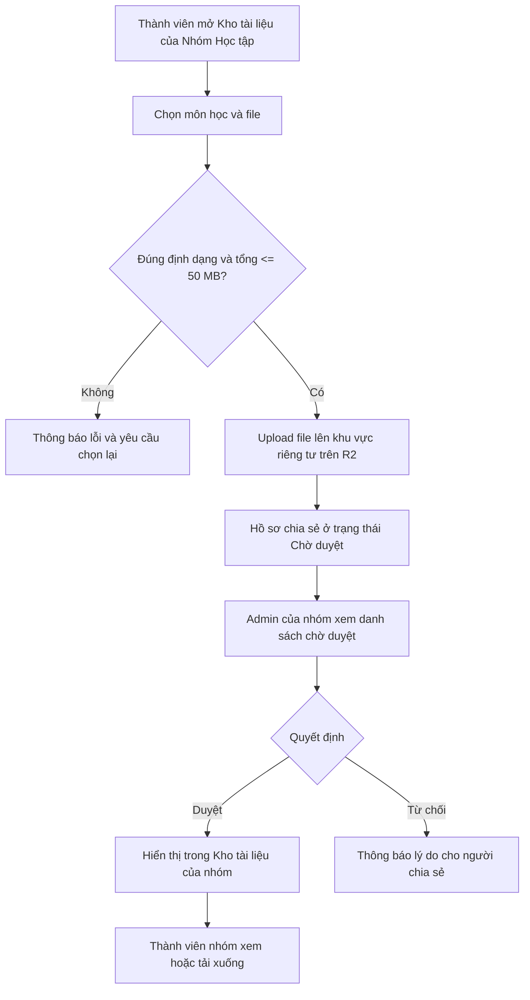
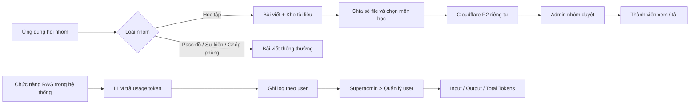

# PHÁC HỌA Ý TƯỞNG: KHO TÀI LIỆU NHÓM HỌC TẬP & THỐNG KÊ TOKEN RAG

> Tài liệu mô tả ý tưởng sản phẩm và luồng UI/UX. Phạm vi gồm **hai tính năng độc lập**: (1) Kho tài liệu **chỉ xuất hiện trong hội nhóm thuộc loại Học tập**; (2) Thống kê token RAG theo người dùng trong khu vực quản trị **Superadmin**. Không triển khai kho tài liệu cho nhóm Pass đồ, Sự kiện hoặc Ghép phòng.

## 1. Mục tiêu và phạm vi

Ứng dụng có các loại hội nhóm/bài đăng như Pass đồ, Sự kiện, Ghép phòng và Học tập. Riêng **hội nhóm Học tập** được bổ sung một khu vực mang tên **Kho tài liệu**, cho phép thành viên chia sẻ tài liệu theo môn học của **Học viện Ngân hàng**. Tài liệu phải được admin của chính nhóm đó phê duyệt trước khi hiển thị công khai cho các thành viên khác.

Song song, giao diện **Superadmin > Quản lý người dùng** cần bổ sung chức năng theo dõi lượng token mà từng tài khoản tiêu thụ khi sử dụng các tính năng RAG trong hệ thống.

### Ranh giới rõ ràng

| Khu vực | Có Kho tài liệu? | Có thống kê token RAG? |
|---|---|---|
| Nhóm Pass đồ | Không | Không hiển thị tại giao diện nhóm |
| Nhóm Sự kiện | Không | Không hiển thị tại giao diện nhóm |
| Nhóm Ghép phòng | Không | Không hiển thị tại giao diện nhóm |
| **Nhóm Học tập** | **Có, một tab/khu vực riêng trong nhóm** | Không hiển thị tại giao diện nhóm |
| **Superadmin > Quản lý người dùng** | Không phải nơi quản lý kho tài liệu nhóm | **Có, theo từng user** |

## 2. Tính năng A — Kho tài liệu chỉ dành cho Nhóm Học tập

### 2.1. Vị trí trong giao diện

Khi mở một hội nhóm **Học tập**, thành viên nhìn thấy các mục:

```text
NHÓM HỌC TẬP: [Tên nhóm]
┌──────────────────────────────────────────┐
│ Bài viết   |   Kho tài liệu              │
├──────────────────────────────────────────┤
│ Kho tài liệu                             │
│ [🔎 Tìm môn học / tên tài liệu ...]      
│ [Bộ lọc môn học ▼]                       │
│                                          │
│ Môn: Cơ sở dữ liệu                       │
│  • Slide chương 1.pdf       [Xem][Tải]   │
│  • Bài tập tuần 2.docx      [Xem][Tải]   │
│                                          │
│ Môn: Kinh tế vi mô                       │
│  • Đề cương ôn tập.pdf      [Xem][Tải]   │
│                                          │
│             [+ Chia sẻ tài liệu]         │
└──────────────────────────────────────────┘
```

**Điều kiện hiển thị:** tab `Kho tài liệu` chỉ được render khi `group.type == STUDY` (tên enum là gợi ý). Không thêm tab này vào mọi loại hội nhóm.

### 2.2. Tìm kiếm và phân loại theo môn học Học viện Ngân hàng

- Người chia sẻ **bắt buộc chọn môn học** từ danh mục môn học thuộc Học viện Ngân hàng.
- Trường chọn môn có tìm kiếm theo tên hoặc mã môn; gợi ý kết quả khi gõ.
- Tài liệu được gắn với môn đã chọn để thành viên lọc, tìm kiếm và duyệt tài liệu theo môn.
- Nếu không tìm thấy môn, hiển thị trạng thái `Không tìm thấy môn học` và hướng dẫn liên hệ quản trị để cập nhật danh mục; không tự động tạo tên môn tùy ý nếu chưa được thống nhất.
- Danh mục môn học nên được quản lý tập trung và cập nhật từ nguồn dữ liệu môn học đã xác minh của Học viện Ngân hàng; **chưa giả định có API chính thức**.

### 2.3. Form chia sẻ tài liệu

| Trường | Bắt buộc | Ghi chú UX |
|---|---|---|
| Môn học | Có | Tìm kiếm và chọn trong danh mục môn học Học viện Ngân hàng |
| Tên tài liệu | Có | Tên dễ hiểu để tìm kiếm |
| File đính kèm | Có | Một hoặc nhiều file hợp lệ, tổng dung lượng tối đa 50 MB/lần chia sẻ |
| Mô tả ngắn | Không | Giúp người khác biết nội dung tài liệu |

```text
CHIA SẺ TÀI LIỆU
┌─────────────────────────────────────────┐
│ Môn học *                               │
│ [🔎 Tìm môn học của Học viện Ngân hàng] │
│ Tên tài liệu *                          │
│ [____________________________________] │
│ Mô tả (tùy chọn)                        │
│ [____________________________________] │
│ File tài liệu *                         │
│ [+ Chọn file]                           │
│ Đã chọn: 18 MB / 50 MB                  │
│                                         │
│ Lưu ý: Tài liệu cần admin nhóm duyệt.   │
│           [Gửi chờ duyệt]              │
└─────────────────────────────────────────┘
```

### 2.4. Định dạng và giới hạn dung lượng

**Chỉ chấp nhận:**

| Nhóm định dạng | Phần mở rộng đề xuất |
|---|---|
| Word | `.doc`, `.docx` |
| Excel | `.xls`, `.xlsx` |
| PowerPoint | `.ppt`, `.pptx` |
| PDF | `.pdf` |
| Ảnh | `.jpg`, `.jpeg`, `.png`, `.webp` |

Các định dạng khác như `.zip`, `.rar`, `.exe`, `.apk`, `.mp4` không được phép chia sẻ trong Kho tài liệu.

**Giới hạn mỗi lần chia sẻ: 50 MB tổng cộng**, không phải 50 MB cho từng file. Ví dụ: 3 file có dung lượng 15 + 20 + 10 = 45 MB được chấp nhận; 30 + 25 = 55 MB bị từ chối. Có thể giới hạn thêm số file mỗi lượt ở giai đoạn triển khai nếu cần, nhưng đây chưa phải yêu cầu bắt buộc.

Backend phải kiểm tra phần mở rộng, MIME type, nội dung thực tế/file signature khi khả thi và kích thước file; không chỉ dựa vào tên file từ client. Giới hạn định dạng và 50 MB/lượt giúp giảm nguy cơ lạm dụng, **nhưng không tự nó bảo đảm R2 không bị đầy**; nên theo dõi tổng dung lượng, số lượt upload và dọn file tạm.

### 2.5. Quy trình duyệt tài liệu



Các trạng thái đề xuất: `PENDING` (chờ duyệt), `APPROVED` (đã duyệt), `REJECTED` (từ chối). Chỉ tài liệu `APPROVED` mới xuất hiện trong danh sách dành cho thành viên. Người chia sẻ xem được trạng thái các tài liệu mình đã gửi.

### 2.6. Phân quyền

| Vai trò | Gửi tài liệu | Xem/tải tài liệu đã duyệt | Duyệt/từ chối | Sửa nội dung file gốc |
|---|---|---|---|---|
| Thành viên nhóm Học tập | Có | Có | Không | **Không** |
| Admin của nhóm Học tập | Có | Có | **Có, trong nhóm mình quản lý** | **Không qua giao diện kho** |
| Người ngoài nhóm | Không | Không | Không | Không |

Thành viên **chỉ có quyền xem và tải về** tài liệu đã được duyệt, không có chức năng chỉnh sửa trực tiếp file đang lưu trong kho. Quyền gửi tài liệu là một hành động riêng, không đồng nghĩa quyền sửa tài liệu đã đăng. Người dùng có thể chỉnh sửa bản sao đã tải về trên thiết bị của họ; điều đó không làm thay đổi file gốc trên R2.

Nên có màn hình `Admin nhóm > Tài liệu chờ duyệt` với tên tài liệu, môn học, người gửi, dung lượng, thời gian gửi, nút xem trước/tải kiểm tra, duyệt, từ chối (nhập lý do).

### 2.7. Lưu trữ Cloudflare R2

- Toàn bộ file của kho được lưu trong **Cloudflare R2**, ở bucket riêng tư; database chỉ lưu metadata, đường dẫn object/key và trạng thái duyệt.
- Không để public URL mở tự do. Backend xác thực tư cách thành viên và trạng thái duyệt trước khi cấp quyền xem/tải bằng signed URL ngắn hạn hoặc cơ chế proxy phù hợp.
- File đang chờ duyệt không được phát hành cho thành viên thường.
- Object key có thể theo mẫu: `study-groups/{groupId}/documents/{documentId}/{randomFileName}`; tránh lấy tên file gốc làm key duy nhất.
- Kiểm soát quyền upload bằng URL ký hoặc backend upload; kiểm tra lại file sau upload trước khi chuyển sang chờ duyệt.
- Có chính sách xử lý file upload dở, file bị từ chối, trùng lặp, và tài liệu bị gỡ để tránh chiếm dung lượng vô ích.
- Tính năng xem trước cần tùy loại file: PDF và ảnh có thể preview trực tiếp; Word/Excel/PowerPoint có thể cần bộ chuyển đổi hoặc chỉ cung cấp tải xuống nếu chưa có trình xem an toàn. Không cam kết mọi định dạng đều xem trực tiếp trong MVP.

### 2.8. Màn hình cần thiết

1. **Nhóm Học tập > Kho tài liệu:** tìm kiếm, lọc theo môn, danh sách tài liệu đã duyệt, xem/tải.
2. **Chia sẻ tài liệu:** chọn môn, nhập tên, chọn file, kiểm tra 50 MB, gửi duyệt.
3. **Tài liệu của tôi:** danh sách tài liệu đã gửi và trạng thái xử lý.
4. **Admin nhóm > Chờ duyệt:** xem thông tin, kiểm tra, duyệt/từ chối và lý do.
5. **Chi tiết tài liệu:** tên, môn, người chia sẻ, loại file, dung lượng, nút xem/tải.

### 2.9. Dữ liệu gợi ý

- `subjects`: `id`, `code`, `name`, `institution` (Học viện Ngân hàng), `is_active`.
- `study_documents`: `id`, `group_id`, `subject_id`, `title`, `description`, `uploaded_by`, `status`, `reviewed_by`, `reviewed_at`, `rejection_reason`, `created_at`.
- `study_document_files`: `id`, `document_id`, `r2_object_key`, `original_name`, `mime_type`, `extension`, `size_bytes`, `created_at`.

Backend phải xác minh `group_id` thực sự là nhóm loại Học tập trước khi cho tạo/lấy tài liệu; không chỉ ẩn tab ở frontend.

## 3. Tính năng B — Superadmin thống kê token RAG theo từng người dùng

> Đây là **tính năng riêng trong hệ thống Superadmin**, không phải chức năng của Kho tài liệu hay của admin nhóm Học tập.

### 3.1. Mục tiêu

Superadmin cần biết mỗi người dùng đã tiêu thụ bao nhiêu token khi sử dụng chức năng RAG của hệ thống, để theo dõi mức sử dụng, đánh giá chi phí và phát hiện bất thường.

**Ba chỉ số bắt buộc cho mỗi user:**

- **Input Tokens:** tổng token đầu vào được model ghi nhận cho các lượt gọi RAG.
- **Output Tokens:** tổng token đầu ra được model ghi nhận cho các lượt gọi RAG.
- **Total Tokens:** tổng token sử dụng, thông thường `input_tokens + output_tokens` theo cách ghi nhận của nhà cung cấp; đối chiếu với usage thực tế nếu có phân loại bổ sung.

Không ước lượng bằng số ký tự nếu provider đã trả về usage chính xác. Phải thống nhất phạm vi tính: token của các lời gọi LLM thuộc pipeline RAG; nếu có embedding/reranking thì nên ghi nhận tách biệt, không âm thầm gộp vào ba chỉ số chat LLM.

### 3.2. Giao diện quản lý user

```text
SUPERADMIN > QUẢN LÝ NGƯỜI DÙNG
┌─────────────────────────────────────────────────────────────────┐
│ [🔎 Tìm theo tên / email]  [Thời gian: 30 ngày ▼]               │
│                                                                 │
│ User              Input Tokens    Output Tokens    Total Tokens │
│ user_a            120,000         35,000           155,000      │
│ user_b             42,000         11,000            53,000      │
│                                                                 │
│ [Xem chi tiết user]                                             │
└─────────────────────────────────────────────────────────────────┘

CHI TIẾT USER > SỬ DỤNG RAG
┌─────────────────────────────────────────────────────────────────┐
│ Input Tokens     Output Tokens      Total Tokens               │
│ 120,000          35,000             155,000                    │
│ [Biểu đồ token theo ngày]                                       │
│ [Lịch sử lượt gọi: thời gian | model | input | output | total]  │
└─────────────────────────────────────────────────────────────────┘
```

Các số trên chỉ là dữ liệu minh họa, không phải thống kê thật.

### 3.3. Hành vi và quy tắc thống kê

- Hiển thị thống kê token ngay trong danh sách user; nhấn vào user để xem chi tiết.
- Bộ lọc thời gian: hôm nay, 7 ngày, 30 ngày, tùy chọn khoảng ngày, toàn thời gian.
- Có thể mở rộng lọc theo model hoặc tính năng RAG nếu hệ thống sử dụng nhiều model.
- Mỗi lần gọi model cần ghi nhận `user_id`, `request_id`, `model`, `timestamp`, `input_tokens`, `output_tokens`, `total_tokens`, `status`.
- Lưu usage được trả về từ nhà cung cấp, bao gồm cả lượt thất bại nếu provider vẫn tính token và có usage; không tự ghi 0 cho trường hợp thiếu dữ liệu.
- Tránh ghi trùng khi request retry hoặc nhận lại callback bằng khóa idempotency phù hợp.
- Một câu hỏi RAG có thể gọi LLM nhiều lần; tổng theo user phải cộng các lần gọi thực tế trong phạm vi đã định nghĩa, không mặc định mỗi câu hỏi chỉ có một lượt.
- Chỉ Superadmin (hoặc vai trò quản trị được cấp phép riêng sau này) được xem thống kê của tất cả user; user thường không xem được token của người khác.

### 3.4. Dữ liệu gợi ý

`rag_token_usage`: `id`, `user_id`, `request_id`, `provider`, `model`, `input_tokens`, `output_tokens`, `total_tokens`, `usage_source`, `status`, `created_at`.

Có thể tạo bảng tổng hợp theo ngày để truy vấn dashboard nhanh, nhưng **bản ghi usage theo lượt gọi** là nguồn dữ liệu đối soát. Mọi tổng hợp phải nhất quán với bộ lọc thời gian.

## 4. Luồng tổng thể và ranh giới chức năng



**Lưu ý:** Không mặc định tài liệu trong Kho tài liệu được đưa vào RAG. Nếu sau này muốn index tài liệu đã duyệt cho RAG, đó là yêu cầu mở rộng riêng, cần quy định thêm quyền truy cập, trích xuất nội dung và cập nhật chỉ mục.

## 5. Tiêu chí nghiệm thu cốt lõi

### Kho tài liệu Nhóm Học tập

- [ ] Chỉ nhóm loại Học tập có tab `Kho tài liệu`; nhóm khác không có.
- [ ] Chỉ thành viên nhóm được gửi, xem và tải tài liệu đã duyệt.
- [ ] Người gửi tìm và chọn được môn học trong danh mục Học viện Ngân hàng.
- [ ] Chỉ cho phép Word, Excel, PowerPoint, PDF, ảnh theo danh sách định dạng.
- [ ] Tổng dung lượng mỗi lần gửi không vượt 50 MB; cả frontend và backend đều kiểm tra.
- [ ] File được lưu trên R2 riêng tư, không lộ đường dẫn tải công khai lâu dài.
- [ ] Tài liệu mới gửi ở trạng thái chờ duyệt, chưa hiển thị cho thành viên khác.
- [ ] Chỉ admin đúng nhóm được duyệt hoặc từ chối.
- [ ] Thành viên xem/tải được tài liệu đã duyệt nhưng không thể sửa file gốc.

### Superadmin — Token RAG

- [ ] Danh sách user hiển thị Input, Output, Total Tokens.
- [ ] Có màn hình chi tiết và bộ lọc thời gian.
- [ ] Usage được ghi nhận theo user và từng lượt gọi model, không tính trùng.
- [ ] Tổng token nhất quán với nguồn usage và khoảng thời gian đã chọn.
- [ ] User thường không thể xem số liệu token của user khác.

## 6. Những điểm nên chốt trước khi code

1. **Danh mục môn học:** lấy từ nguồn quản trị nội bộ hay nguồn chính thức được xác minh của Học viện Ngân hàng?
2. **50 MB:** tài liệu này hiểu là tổng dung lượng mọi file trong một lần chia sẻ, không phải mỗi file.
3. **File bị từ chối:** giữ tạm để người gửi xem lý do hay xóa sau một thời hạn?
4. **Preview Office:** có cần xem Word/Excel/PowerPoint ngay trong ứng dụng ở MVP hay cho tải xuống trước?
5. **Thống kê token:** chỉ token của các lời gọi LLM trong RAG, hay cần thêm bảng riêng cho embedding/reranking?

---

**Kết luận:** Có **hai yêu cầu song song**: (A) thêm **Kho tài liệu độc quyền cho Nhóm Học tập**, với môn học Học viện Ngân hàng, duyệt bởi admin nhóm, file lưu R2, định dạng hạn chế và tối đa 50 MB/lượt; (B) thêm **thống kê Input/Output/Total Tokens RAG theo từng user trong Superadmin**. Hai tính năng không được gộp thành một màn hình hay áp dụng kho tài liệu cho mọi hội nhóm.
